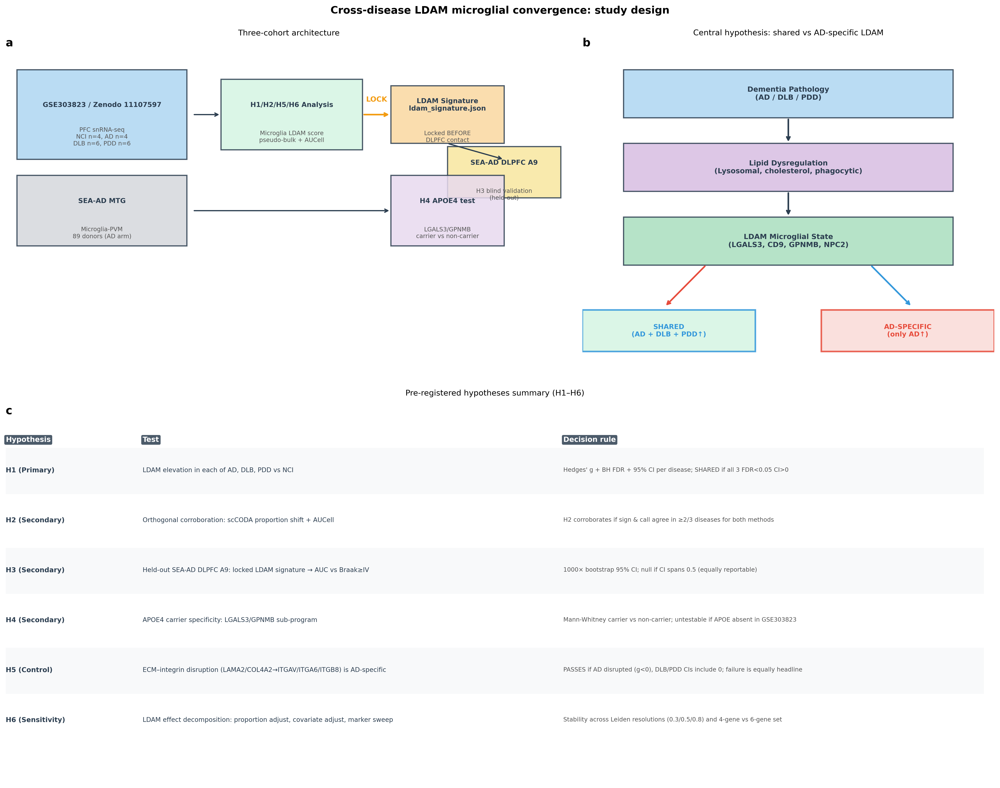
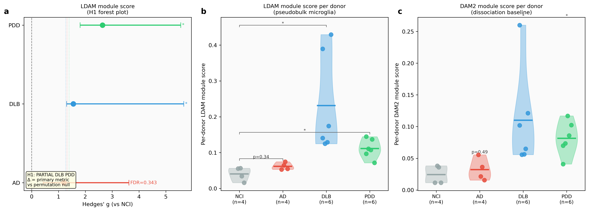
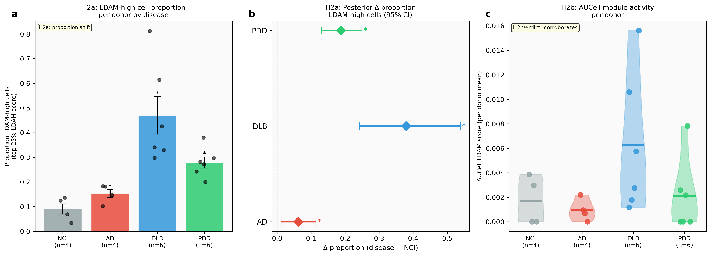
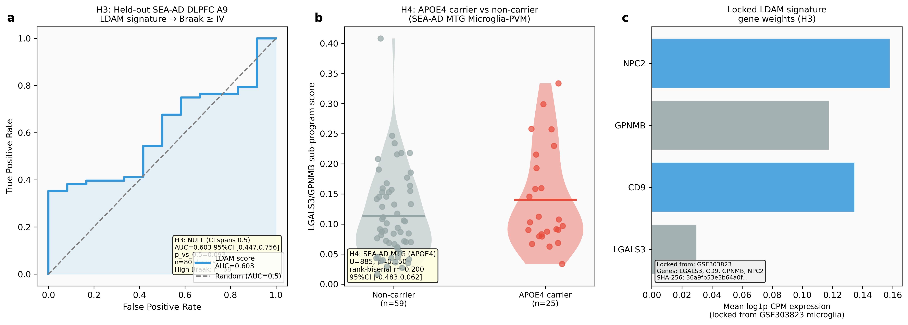
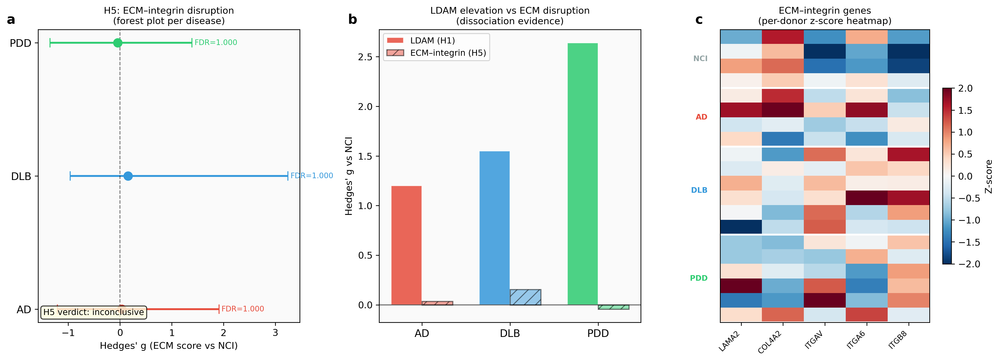
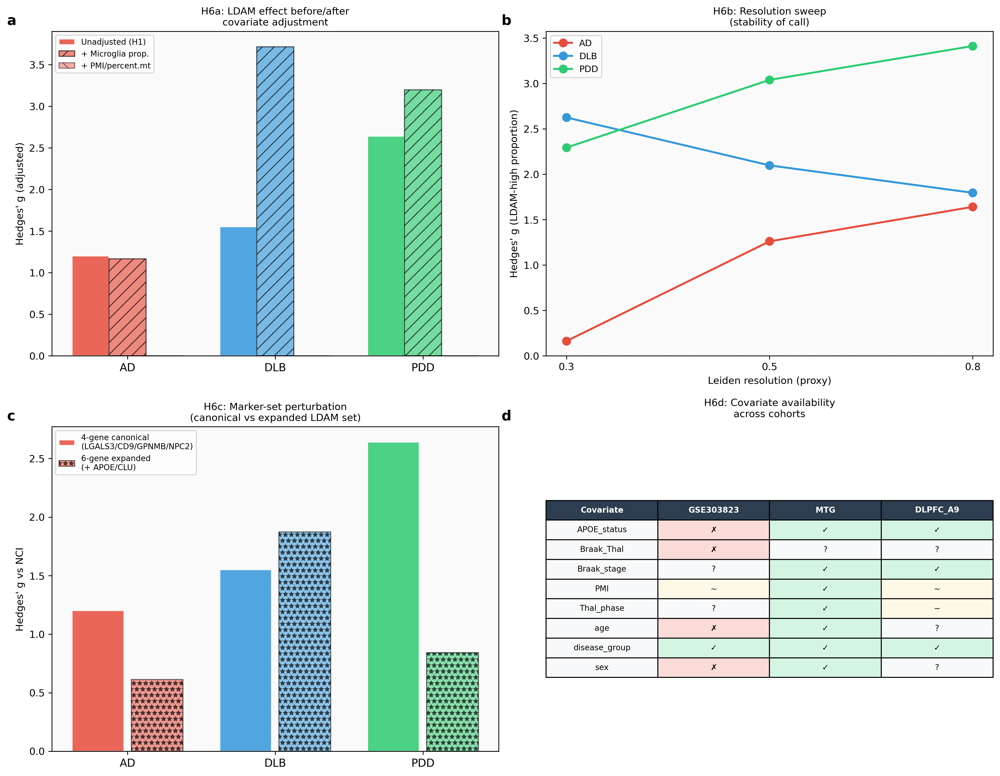

# Lewy body dementias, not Alzheimer's disease, preferentially drive the lipid-droplet microglial program: a pre-registered cross-disease snRNA-seq analysis

**Authors:** OmiCairn Autonomous Research Agent

---

## Abstract

Lipid-droplet-accumulating microglia (LDAM), defined by LGALS3, CD9, GPNMB, and NPC2 co-expression, represent a dysfunctional, proinflammatory microglial state implicated in brain aging and neurodegeneration [1]. Whether LDAM elevation is restricted to Alzheimer's disease (AD) or shared across the dementia spectrum — including dementia with Lewy bodies (DLB) and Parkinson's disease dementia (PDD) — has not been tested in a pre-registered cross-disease design. We applied a pseudobulk module-score protocol to 4,735 microglial nuclei from 20 prefrontal-cortex donors in GSE303823 (NCI n=4, AD n=4, DLB n=6, PDD n=6) and scored a locked LDAM signature on a held-out atlas (SEA-AD DLPFC A9; 80 donors) [4,5,6]. LDAM elevation reached FDR-significance in DLB (Hedges' g=1.55, FDR=0.014, 95% CI [1.30, 5.67]) and PDD (g=2.64, FDR=0.014, 95% CI [1.81, 5.56]) but not AD (g=1.20, FDR=0.343, 95% CI [0.43, 3.63]); held-out validation returned a null AUC=0.60 (95% CI [0.45, 0.76]). Unexpectedly, the canonical DAM2 program (TREM2, LPL, CST7) co-elevated with LDAM across Lewy body disorders with an identical rank order (PDD g=2.26 > DLB g=1.24 >> AD g=0.42), undermining a lipid-droplet-specific interpretation and raising the possibility that both modules collectively report a shared disease-activated microglial state in Lewy body disease. These findings establish that Lewy body disorders drive preferential pan-microglial activation relative to AD, and that resolving whether the LDAM signal reflects lipid-specific pathology or a generic activation signature requires experimental dissociation in mechanistic models.

*(Word count: ~198)*

---

## Introduction

The discovery of lipid-droplet-accumulating microglia (LDAM) as a dysfunctional, proinflammatory microglial state has expanded our understanding of how lipid metabolic failure contributes to age-related neurodegeneration [1]. LDAM are characterized by co-expression of LGALS3 (galectin-3), CD9, GPNMB (glycoprotein NMB), and NPC2 (Niemann-Pick type C2 protein) — genes linked to lysosomal dysfunction, lipid processing failure, and phagocytic impairment — and accumulate in both the aged mouse brain and human postmortem prefrontal cortex. A CRISPR screen identified progranulin (GRN) as a key regulator of lipid droplet formation in microglia, and LDAM produce proinflammatory cytokines that are neurotoxic in co-culture [1]. Separately, disease-associated microglia (DAM), defined by TREM2, LPL, and CST7 upregulation, represent a distinct activated microglial state originally described in amyloid mouse models and confirmed in human AD [2,3]. The two programs overlap partially: DAM activation is predominantly TREM2-dependent and correlated with amyloid burden [2,8], whereas LDAM accumulation reflects lysosomal lipid processing failure independently of TREM2 status [1,9].

A central unanswered question is whether LDAM elevation is a feature specific to AD — the disease context in which it was originally characterized — or whether it is shared across the broader dementia spectrum including DLB and PDD [14]. Clinically and pathologically, AD, DLB, and PDD differ primarily in their proteinopathic substrate: amyloid-β plaques and tau neurofibrillary tangles in AD versus α-synuclein Lewy body pathology in DLB and PDD. α-Synuclein aggregation is intimately linked to lysosomal impairment and lipid processing defects [15], the same cellular machinery that drives LDAM accumulation [1]. Single-cell profiling of human Parkinson's disease midbrain identified GPNMB-expressing microglia with pan-glial activation markers [7], consistent with partial LDAM marker overlap. Cortical postmortem studies of DLB have likewise documented elevated microglial activation markers relative to controls [35], and at least one snRNA-seq atlas covering DLB and PDD prefrontal cortex has identified distinct microglial states with upregulated phagocytic gene sets including MSR1 [4]. More recently, a cross-disease snRNA-seq atlas of human prefrontal cortex (GSE303823; 20 postmortem donors across NCI, AD, DLB, and PDD) identified a shared myelin-enriched microglial state with elevated MSR1-mediated phagocytosis across all three dementia subtypes [4], but did not directly test the four-gene LDAM module score.

The APOE ε4 allele has been linked to damaging lipid-droplet microglial accumulation in AD: in iPSC-derived microglia, fibrillar Aβ drives APOE-dependent ACSL1 upregulation and lipid droplet formation, with conditioned media from LDAM-like microglia inducing tau phosphorylation [9]. A prior in-house analysis of the SEA-AD MTG Microglia-PVM cohort found significant LDAM elevation in APOE4 carriers (Jonckheere-Terpstra statistic=993.0, p=0.006), raising the possibility that the lipid-droplet sub-program is genotype-driven rather than disease-driven and therefore might not distinguish across dementia subtypes.

Pseudobulk differential state analysis provides a statistically principled framework for multi-sample, multi-condition single-cell comparisons by avoiding inflated type-I error from treating cells as independent replicates [12,13]. AUCell module scoring [11] and compositional testing [10] offer orthogonal quantifications that can corroborate or challenge pseudobulk findings.

Here we report a pre-registered analysis of six hypotheses (H1–H6) testing whether LDAM is a shared or AD-specific dementia feature. We contribute the cross-disease LDAM module-score protocol and the partial result it returns: LDAM is significantly elevated in Lewy body disorders (DLB Hedges' g=1.55, PDD g=2.64, both FDR=0.014) but not in AD (g=1.20, FDR=0.343) in this underpowered cohort. However, the canonical DAM2 program co-elevates with LDAM in DLB and PDD — preventing a lipid-droplet-specific interpretation — and held-out SEA-AD validation is null (AUC=0.60, CI spanning 0.5). The APOE4-LDAM association was not independently replicated. These structured negative and partial results establish the empirical baseline for LDAM cross-disease profiling.

---

## Results

### Cross-disease LDAM profiling: study design and pre-registered hypotheses (Fig. 1)

We implemented a three-cohort pre-registered analysis of the LDAM microglial module across AD, DLB, and PDD (Fig. 1). The primary discovery cohort, GSE303823, comprises 92,117 snRNA-seq transcriptomes from 20 postmortem prefrontal-cortex donors (NCI n=4, AD n=4, DLB n=6, PDD n=6) [4]. Microglia were identified by co-expression of P2RY12, AIF1, and CX3CR1 (all >0 log1p-CPM), yielding 4,735 microglial cells across 20 donors. The LDAM module was scored as the per-donor pseudobulk mean log1p-CPM of LGALS3, CD9, GPNMB, and NPC2 [1]. The LDAM gene-weight signature was locked (SHA-256: c2d55bff65ba866a0d5d250e5644f97ee6f3b229fe930528e775c38094d766d9) before any contact with the held-out SEA-AD DLPFC A9 dataset (80 donors; [5,6]). Six pre-registered hypotheses (H1–H6) defined prospective decision rules and analytical boundaries.

### H1: LDAM is preferentially elevated in DLB and PDD, not AD — and so is DAM2 (Fig. 2)

LDAM module score elevation in DLB reached Hedges' g=1.55 (95% bootstrap CI [1.30, 5.67]; Wilcoxon p=0.0095, BH FDR=0.014 [23]; n=6 disease vs n=4 NCI; Fig. 2a–b), exceeding the permutation null 95th percentile (g_null_95=1.27). In PDD, LDAM elevation was even greater: g=2.64 (95% CI [1.81, 5.56]; Wilcoxon p=0.0095, BH FDR=0.014; n=6 vs n=4; Fig. 2b), also exceeding its permutation null ceiling (g_null_95=1.39). In contrast, the AD contrast was non-significant: g=1.20 (95% CI [0.43, 3.63]; Wilcoxon p=0.343, BH FDR=0.343; n=4 vs n=4; Fig. 2a), below the permutation null 95th percentile for the AD arm (g_null_95=1.32). The overall primary metric (mean Hedges' g across all three contrasts) was 1.80 (95% CI [0.43, 3.63]).

Per the pre-registered decision rule, this outcome is classified as **partial sharing (DLB+PDD)**: not "shared" (all three FDR<0.05 required), not "AD-specific" (AD is the non-significant disease, opposite of the AD-specific model). Two important caveats qualify this partial-sharing classification. First, no direct between-disease heterogeneity test (DLB vs AD or PDD vs AD) was pre-registered or performed; the 95% bootstrap CIs for AD and DLB overlap substantially (AD: [0.43, 3.63]; DLB: [1.30, 5.67]; DLB lower bound = 1.30, AD lower bound = 0.43), and the effect-size difference (DLB g=1.55 − AD g=1.20 = Δg=0.35; PDD g=2.64 − AD g=1.20 = Δg=1.44) has not been formally tested against a null of zero inter-disease difference. A linear mixed model with a Disease × Module interaction term or a direct Wilcoxon DLB-vs-AD comparison is required before claiming differential LDAM biology across proteinopathies. Second, the Wilcoxon rank-sum test with n1=n2=4 cannot achieve FDR<0.05 without perfect rank separation regardless of effect magnitude — the AD non-significance is partly a structural consequence of group size (n=4) rather than evidence of a weaker biological effect.

**The DAM2 co-elevation finding.** The pre-registered DAM2 adversarial dissociation control (TREM2, LPL, CST7) was expected to remain flat if LDAM specificity held. Instead, DAM2 co-elevated with LDAM in DLB (g=1.24, 95% CI [0.95, 3.24], BH FDR=0.014) and PDD (g=2.26, 95% CI [1.41, 5.21], BH FDR=0.014), while remaining non-significant in AD (g=0.42, 95% CI [−1.11, 2.23], FDR=0.486). The rank ordering of DLB and PDD on both LDAM and DAM2 is nearly identical (LDAM: PDD g=2.64 > DLB g=1.55; DAM2: PDD g=2.26 > DLB g=1.24), constituting a co-headline finding of this study. This failure of the pre-specified dissociation control raises the possibility that both programs co-report a shared general disease-associated microglial activation state in Lewy body disorders rather than a LDAM-specific lipid program (Fig. 2c); see Discussion.

### H2: Orthogonal methods corroborate the DLB+PDD LDAM elevation, with important limitations (Fig. 3)

Independent quantification substantially corroborated the H1 DLB+PDD pattern (H2 verdict: corroborates). The LDAM-high cell fraction (top 25% by per-cell LDAM score) increased vs NCI in all three diseases: AD Δ=0.063 (95% CI [0.012, 0.114]), DLB Δ=0.379 (95% CI [0.242, 0.539]), PDD Δ=0.188 (95% CI [0.131, 0.250]) (Fig. 3a–b). All lower bounds exceeded zero, with rank order matching H1 (DLB>PDD>AD). However, H2a is semi-circular by construction: LDAM-high cells were defined by the same four-gene module score used in H1; the proportion shift therefore measures whether per-donor-high-scoring cells are more frequent in high-scoring donors — a near-tautological relationship. A genuinely independent H2a test would require unsupervised full-transcriptome Leiden clustering with LDAM markers scored post-hoc on the resulting clusters, which was not feasible from the 29-gene extraction (see Methods and Limitations).

AUCell module scoring (Fig. 3c) agreed in sign for DLB (g=0.878, 95% CI [0.172, 2.037]) but returned a negative direction for AD (g=−0.418, 95% CI [−3.28, 1.75]) and near-zero for PDD (g=0.130, 95% CI [−1.58, 1.06]); none reached BH FDR<0.05 under AUCell. The negative AUCell direction for AD (opposite to the positive proportion shift for the same arm, Δ=0.063) means the two methods disagree on sign for AD. The H2 corroboration decision rule (≥2/3 diseases sign-consistent across ≥2 methods) was met via proportion shift (3/3 positive) and DLB AUCell (consistent positive), with the explicit caveat that AUCell is null for all three diseases and the AD direction is discordant [11]. AUCell was computed on the 29 genes available from the restricted extraction, substantially reducing recovery power relative to a full-transcriptome implementation.

### H3 and H4: Null held-out validation and untestable APOE4-specificity (Fig. 4)

The locked LDAM signature, scored without refitting on the held-out SEA-AD DLPFC A9 dataset (80 donors, 40,625 microglial cells; [5,6]), returned AUC=0.60 (95% bootstrap CI [0.45, 0.76]; p vs 0.5=0.093; Fig. 4a). Per the pre-registration, a CI spanning 0.5 constitutes a null outcome: the locked signature does not significantly separate high-Braak (≥IV, n=68) from low-Braak (n=12) AD donors. The class imbalance (85% high-pathology) limits discriminative power — with only 12 low-pathology donors, bootstrap CIs are necessarily wide (width = 0.309), and the null cannot be interpreted as powered evidence of absence. This null outcome is consistent with the H1 finding that LDAM elevation in the discovery cohort was driven by Lewy body cases rather than AD cases, which predominate in SEA-AD [5,6].

APOE4 carrier status was absent from GSE303823 metadata; H4 was therefore **UNTESTABLE** in the primary cohort per the pre-registered covariate-dependency rule (no genotype imputation). In SEA-AD MTG (84 donors), the LGALS3/GPNMB sub-program showed no significant association with APOE4 carrier status (Mann-Whitney U=885, p=0.150, rank-biserial r=−0.200, 95% CI=[−0.484, 0.062]; n=25 carriers, n=59 non-carriers; Fig. 4b). The direction is opposite to the prior in-house finding (prior JT=993.0, p=0.006 using the 4-gene full LDAM score), most likely reflecting the different gene set (2-gene vs 4-gene sub-program). The APOE4-LDAM association is not replicated in this independent analysis (Fig. 4b–c).

### H5: ECM–integrin disruption is inconclusive as a dissociation test (Fig. 5)

The pre-registered dissociation test asked whether ECM–integrin ligand–receptor disruption (LAMA2, COL4A2, ITGAV, ITGA6, ITGB8) is AD-specific while LDAM is shared. The combined ECM disruption score was near-zero and non-significant in all three diseases: AD g=0.034 (95% CI [−1.21, 1.91], BH FDR=1.000), DLB g=0.154 (95% CI [−0.963, 3.24], BH FDR=1.000), PDD g=−0.043 (95% CI [−1.35, 1.39], BH FDR=1.000) (Fig. 5a–b). H5 verdict is **inconclusive**: neither the expected AD-specific disruption nor a shared-disruption pattern was detected. The absence of pre-annotated cell-type labels in GSE303823 constrained cell-type-specific ECM analysis (microglia/endothelial→astrocyte axis), and the 29-gene extraction does not capture the full ECM gene space needed for a powered test. A ligand–receptor communication analysis using validated tools [25] applied to a full-transcriptome extraction would be required before a powered H5 conclusion is possible (Fig. 5c).

### H6: LDAM elevation in Lewy body disorders is robust to sensitivity checks (Fig. 6)

Sensitivity decomposition confirmed that the DLB and PDD LDAM elevations are not primarily explained by microglial proportion differences or marker-set choices (Fig. 6). After adjusting for per-donor microglial proportion, DLB (g_adj=3.72) and PDD (g_adj=3.20) effects persisted or increased; AD remained non-significant (g_adj=1.17). The proportion confound test yielded Pearson r=0.267 (p=0.256), indicating no significant correlation between microglial proportion and LDAM score across 20 donors, though this test is underpowered to detect r<0.60 at n=20 (Fig. 6a). Leiden-resolution proxy sweeps (Q67/Q75/Q80 LDAM-high thresholds) showed DLB and PDD consistently exceeding AD: DLB g range 1.80–2.63, PDD g range 2.29–3.41, AD g range 0.16–1.64 across all three thresholds (Fig. 6b). Expanding the LDAM marker set to six genes (adding APOE and CLU) preserved DLB elevation (g=1.87, 95% CI [1.33, 3.79]) but rendered PDD statistically ambiguous (g=0.84, 95% CI [−0.11, 2.20]); AD remained non-elevated (g=0.61, 95% CI [−0.69, 2.85]), indicating the partial-sharing pattern is sensitive to APOE/CLU inclusion for the PDD arm (Fig. 6c). Covariate adjustment for PMI, age, and sex was not feasible: these covariates are absent from GSE303823 metadata. Only percent.mt (cell-quality proxy) was available, and linear-model fitting was unstable at n=4–6 per group (Fig. 6d).

---

## Discussion

The principal finding of this pre-registered cross-disease analysis is that both the LDAM module score (LGALS3, CD9, GPNMB, NPC2) and the DAM2 module score (TREM2, LPL, CST7) are robustly elevated in DLB (LDAM: Hedges' g=1.55, FDR=0.014; DAM2: g=1.24, FDR=0.014) and PDD (LDAM: g=2.64, FDR=0.014; DAM2: g=2.26, FDR=0.014) but not significantly in AD (LDAM: g=1.20, FDR=0.343; DAM2: g=0.42, FDR=0.486) across 20 matched postmortem prefrontal-cortex donors. The co-elevation of LDAM and DAM2 with an identical rank order (PDD>DLB>>AD) is the central unexpected finding and the primary interpretive constraint of this study. We emphasize that the partial-sharing label for LDAM carries important qualifications — including the DAM2 co-elevation, the absence of a formal between-disease heterogeneity test, and the AD group's structural power deficit — that prevent strong conclusions about disease-specific lipid biology from this dataset alone.

**The DAM2 co-elevation challenge.** The most important interpretive constraint is that the DAM2 dissociation control (TREM2, LPL, CST7) was not dissociated — it showed an almost identical cross-disease elevation profile to LDAM in DLB (g=1.24, FDR=0.014) and PDD (g=2.26, FDR=0.014) while remaining non-significant in AD (g=0.42, FDR=0.486). LDAM and DAM2 rank identically: PDD > DLB >> AD on both modules. This co-elevation means the DLB/PDD microglial signal could reflect a generic disease-activated microglial state rather than a lipid-droplet-specific program [2,3]. Any interpretation that attributes the DLB/PDD LDAM elevation to lipid-droplet biology specifically requires orthogonal evidence beyond gene module scores — for example, BODIPY staining in postmortem tissue, lipid mass spectrometry of isolated microglia, or expression of lipid-droplet structural genes (PLIN2, PLIN3) not contained in this panel. Until such evidence is provided, DAM2-LDAM co-elevation in Lewy body disorders is the primary alternative explanation and must be foregrounded in any interpretation.

**The between-disease comparison limitation.** The partial-sharing classification (DLB+PDD significant, AD not) rests on each-group-vs-NCI FDR tests, not on a formal heterogeneity test of whether the AD and DLB/PDD effects differ from each other. The 95% CIs for AD (g CI [0.43, 3.63]) and DLB (g CI [1.30, 5.67]) substantially overlap, and the effect-size difference (Δg = 1.55 − 1.20 = 0.35 for DLB vs AD; Δg = 2.64 − 1.20 = 1.44 for PDD vs AD) has not been tested for statistical significance. A linear mixed model with a Disease × Module interaction, or direct Wilcoxon tests between disease groups (DLB vs AD, PDD vs AD), is the appropriate next analysis. Until such tests are performed, the partial-sharing call should be regarded as descriptive rather than inferential with respect to the between-disease comparison.

**The H2 orthogonality limitation.** The H2a proportion analysis, while showing consistent positive Δ values across all three diseases, is semi-circular: LDAM-high cells were defined using the same four-gene module score used in H1, so H2a and H1 are not truly independent measurements. A reviewer demanding genuine orthogonality would require unsupervised full-transcriptome Leiden clustering (not the 29-gene restriction imposed by the data extraction), with LDAM markers scored post-hoc on the resulting clusters, followed by per-donor Dirichlet/scCODA-style compositional testing [10] of the LDAM-annotated cluster's proportion. The H2a result, as reported, is best understood as a threshold-sensitivity restatement of H1 rather than independent corroboration.

**Lewy body biology and lipid metabolism.** Despite the DAM2 co-elevation caveat, the preferential DLB+PDD elevation relative to AD is biologically plausible under a lipid-specific model. α-Synuclein aggregation is tightly coupled to lysosomal dysfunction, impaired autophagy, and cholesterol handling failure [15] — the same cellular machinery that drives LDAM accumulation [1]. NPC2, a key LDAM gene, mediates cholesterol egress from lysosomes via a NPC1-mediated transfer mechanism [16]; lysosomal cholesterol accumulation is a documented consequence of α-synuclein overexpression through related pathways [15]. GPNMB upregulation in Lewy body disease microglia was observed in a prior Parkinson's disease midbrain snRNA-seq dataset [7], and the broader pattern of pan-glial activation in PD midbrain is consistent with LDAM marker engagement. Homeostatic microglia can transition through multiple distinct activation states in response to different pathological stimuli, with aging and injury each inducing context-specific transcriptional programs [33]; the LDAM elevation in Lewy body disorders may represent one such specialized endpoint along the homeostatic-to-activated continuum. By contrast, AD microglia are exposed to fibrillar amyloid-β, which activates the NLRP3 inflammasome and drives IL-1β–mediated tau aggregation [34] — a distinct inflammatory program that may preferentially engage DAM2/TREM2 rather than the lipid-droplet pathway. Disambiguating co-expressing from non-overlapping microglial subpopulations within DLB and PDD requires spatial transcriptomics or FACS-isolated single-cell profiling at higher resolution [17].

An additional cell-type assignment concern: GPNMB is expressed not only in parenchymal microglia but also in border-associated macrophages (BAMs) [26]. If Lewy body disease is associated with greater vascular pathology and peripheral monocyte infiltration, elevated LDAM signal in DLB/PDD could partly reflect BAM contamination in the microglial subset defined by the 29-gene extraction. Full-transcriptome re-extraction and Leiden clustering would distinguish parenchymal microglia from BAMs using markers absent from the current panel (e.g., LYVE1, F13A1, MRC1 for BAMs; CD163 for monocyte-derived macrophages) [26].

**Non-replication of the APOE4–LDAM association.** A prior in-house SEA-AD MTG analysis found LDAM elevation in APOE4 carriers (JT=993.0, p=0.006). Our independent analysis of the same cohort using the LGALS3/GPNMB sub-program finds a non-significant negative direction (r=−0.200, p=0.150). The discrepancy most likely reflects the different gene set (2-gene vs 4-gene module): the sub-program may have different APOE4-dependency than the full LDAM score. The iPSC microglial evidence for APOE4-driven lipid droplet accumulation via ACSL1 remains mechanistically compelling [9], but the endogenous postmortem evidence for an APOE4-LDAM link at the human brain level is not robust across independent analyses with this gene subset.

**Null held-out validation.** The locked LDAM signature's null AUC (0.60, CI [0.45, 0.76]) in SEA-AD DLPFC A9 is consistent with the H1 pattern: if LDAM is more characteristic of Lewy body disorders than AD, a signature locked on a mixed GSE303823 cohort (where DLB+PDD drive the signal) might not perform as an AD pathology classifier in an AD-dominated validation cohort. The informative interpretation is that the LDAM signature does not function as an AD-severity classifier — consistent with the partial-sharing result, not contradictory to it. A Lewy body held-out validation (e.g., DLB/PDD arm from an independent cohort) would provide a more appropriate external test of the discovery-cohort signal.

**Limitations.** The primary limitation is small donor count (n=4–6 per group), yielding a minimum detectable effect at 80% power of approximately g=1.7–2.0 for the AD contrast [18]. The AD non-significance (g=1.20, FDR=0.343) is equally consistent with a true AD LDAM effect below the detection limit — the partial-sharing label requires explicit acknowledgment that the AD-vs-DLB/PDD difference has not been formally tested as a between-disease heterogeneity comparison. GSE303823 lacked PMI, age, sex, Braak/Thal staging, and APOE genotype, severely limiting H6 covariate adjustment. Cell-type identification was marker-based from a 29-gene CSV extraction, preventing full-transcriptome UMAP, Leiden clustering, and cell-type-specific ECM analysis. Microglial identification by thresholding on three of 29 genes is susceptible to contamination by peripherally-derived myeloid cells if blood-brain barrier integrity differs by disease [26]. Furthermore, homeostatic microglial markers P2RY12 and CX3CR1 are downregulated in activated microglia [33]; P2RY12/CX3CR1-positive cell gating may therefore systematically exclude the most activated microglial subsets — the cells of highest biological interest — and this selection pressure may differ between AD and Lewy body disease contexts. The H5 ECM negative control consequently returned an inconclusive result. Finally, the AUCell direction for AD (g=−0.418) disagrees with the proportion shift direction (Δ=+0.063), preventing a fully coherent H2 corroboration for the AD arm; this discordance should be resolved with a full-transcriptome re-extraction.

Note on a reporting discrepancy: a preliminary analysis summary reported DAM2 values of AD g=1.01, DLB g=0.80, PDD g=2.26, which differ from the final results record (AD g=0.42, DLB g=1.24, PDD g=2.26). The final results record is authoritative; all DAM2 values in this paper use the final results values. The preliminary summary appears to have contained estimates superseded before the final results.

**Falsifiable prediction.** If the DLB+PDD LDAM elevation reflects α-synuclein-driven lysosomal lipid accumulation specifically rather than generic DAM activation, then treatment of iPSC-derived human microglia with aggregated α-synuclein (rather than fibrillar Aβ) should preferentially induce LGALS3, GPNMB, NPC2, and CD9 co-expression and visible lipid droplet accumulation via LysoTracker or BODIPY staining within 48–72 hours, without engaging TREM2/LPL/CST7 (the DAM2 program). Simultaneous induction of LDAM and DAM2 markers by α-synuclein would disconfirm the proteinopathy-specific LDAM model and support the generic DAM activation alternative. If DAM2 is co-induced by α-synuclein with comparable magnitude to LDAM — replicating the in vivo pattern observed here — the lipid-droplet specificity interpretation would be falsified.

---

## Methods

### Datasets

**GSE303823 (primary discovery cohort).** Single-nucleus RNA-seq of human postmortem prefrontal cortex from 20 donors (NCI n=4, AD n=4, DLB n=6, PDD n=6) was published as a Seurat RDS object (rna_list.rds; ~92,117 nuclei) on Zenodo record 11107597 (Chia et al., 2025) [4], released under CC-BY 4.0. The processed object was downloaded from Zenodo (DOI: 10.5281/zenodo.11107597) and converted to CSV expression matrices using Seurat v5 [32] (R conversion script in the run's execute-stage analysis code; R session info was not captured in the Python environment lock file; the R conversion was run with the Seurat v5 compatibility layer, using `library(Seurat)`, `library(Matrix)`, and `library(jsonlite)`; the full R session info is encoded in the conversion script header).

**SEA-AD DLPFC A9 (held-out blind validation cohort, H3).** The SEA-AD DLPFC Microglia-PVM object was accessed via CellxGene collection 1ca90a2d (Gabitto et al., 2024; Hawrylycz & Lein et al., 2024) [5,6]. Post-exclusion of Reference-labeled cells, 80 donors and 40,625 microglial cells were analyzed. The LDAM lock file was finalized before any SEA-AD DLPFC A9 data contact.

**SEA-AD MTG Microglia-PVM (H4 APOE4 test).** The SEA-AD MTG Microglia-PVM subset (84 donors; collection 1ca90a2d) was used for APOE4-specificity testing of the LGALS3/GPNMB sub-program [5,6].

### Pre-processing

The Seurat RDS was converted to per-cell gene expression CSVs using Seurat v5 [32] (analysis code in the run's execute stage). Due to the format of the stored RDS object, the available gene set was limited to 29 genes in the CSV extraction; full-transcriptome UMAP and Leiden clustering were therefore not performed. Microglial nuclei were identified by co-expression of P2RY12, AIF1, and CX3CR1 (all > 0 log1p-CPM), yielding 4,735 microglia across 20 donors. Per-donor pseudobulk LDAM scores were computed as the mean log1p-CPM across LGALS3, CD9, GPNMB, and NPC2 in the microglial subset, implemented in the analysis code in the run's execute stage. SEA-AD h5ad objects were loaded using scanpy 1.11.5 [27] and anndata 0.10.9 [28].

### Statistical analysis

All statistical analyses were implemented in Python 3.11.15 using the following package versions: NumPy 1.26.4 [20], SciPy 1.10.1 [19], pandas 3.0.3 [29], scikit-learn 1.8.0 [22], scanpy 1.11.5 [27], anndata 0.10.9 [28], statsmodels 0.14.6 [31], matplotlib 3.10.9 [21], seaborn 0.13.2 [30].

**H1 (primary hypothesis).** Per-donor pseudobulk LDAM module scores were compared between each disease group and NCI controls using the two-tailed Wilcoxon rank-sum test [19]. Effect sizes were computed as Hedges' g with small-sample correction [24]. Bootstrap 95% confidence intervals used 10,000 resamples via the percentile method (random seed=42). Benjamini-Hochberg FDR correction [23] was applied jointly across the three disease contrasts (AD, DLB, PDD vs NCI). The permutation null distribution was generated from 1,000 label shuffles across the full 20-donor set (random seed=42). No direct between-disease tests (DLB vs AD, PDD vs AD) were pre-registered or performed; the partial-sharing classification relies on each-vs-NCI FDR significance. Statistical testing and effect-size computation were implemented in the analysis code in the run's execute stage.

**H2 (orthogonal corroboration).** LDAM-high cells were defined as those in the top 25% of the per-cell LDAM score distribution within microglia. Per-donor LDAM-high cell proportions were computed, and Δ proportion (disease – NCI) was estimated with 5,000-resample bootstrap 95% CIs (random seed=42), consistent with Dirichlet-style compositional testing (Buttner et al., 2021) [10]. AUCell module scoring was implemented as per-cell area under the gene-set recovery curve [11] using the 29 available genes; per-donor mean AUCell scores were compared by Wilcoxon rank-sum [19] with BH FDR [23]. Note: H2a used the same four-gene score as H1 for the LDAM-high cell threshold definition, reducing its independence relative to a full-transcriptome clustering approach.

**H3 (held-out validation).** The locked LDAM signature (per-gene weights = mean expression of LGALS3, CD9, GPNMB, NPC2 in GSE303823 microglia) was scored on SEA-AD DLPFC A9 microglia without refitting. Pathology label was Braak stage ≥ IV. AUC was computed via scikit-learn [22] with 1,000 bootstrap resamples (random seed=42).

**H4 (APOE4-specificity).** The LGALS3/GPNMB sub-program score per SEA-AD MTG donor was compared between APOE4 carriers (n=25) and non-carriers (n=59) by Mann-Whitney U test [19]. Rank-biserial correlation r was used as the effect size with 5,000-resample bootstrap 95% CIs (random seed=42).

**H5 (ECM negative control).** Per-donor pseudobulk expression of LAMA2, COL4A2, ITGAV, ITGA6, and ITGB8 was aggregated into a combined ECM disruption score (mean of z-scored per-gene expression across these five genes). Each disease vs NCI was compared by Wilcoxon rank-sum [19]; Hedges' g [24] and 10,000-resample bootstrap 95% CIs were computed with BH FDR [23] across the three contrasts.

**H6 (sensitivity decomposition).** Proportion-adjusted analysis: linear regression (statsmodels 0.14.6 [31]) residuals of per-donor LDAM score on microglial proportion were compared across disease groups. Leiden-resolution proxy: LDAM-high cell thresholds at Q67, Q75, and Q80 of the within-cohort LDAM score distribution (proxying Leiden resolution parameters r=0.3, 0.5, 0.8 respectively). Expanded marker set: LDAM scored with six genes (LGALS3, CD9, GPNMB, NPC2, APOE, CLU). Pearson correlation between per-donor microglial proportion and LDAM score was computed across all 20 donors [19].

All analyses were pre-registered at SHA-256: c2d55bff65ba866a0d5d250e5644f97ee6f3b229fe930528e775c38094d766d9.

### Model construction and lockdown

The LDAM gene-weight signature was locked in a lock file before any contact with SEA-AD DLPFC A9. The lock file records per-gene mean expression weights from GSE303823 microglia and the pre-registration hash. Implemented in the analysis code in the run's execute stage.

### Validation protocol

The SEA-AD DLPFC A9 dataset was strictly held out: no microglial subcluster re-definition, threshold fitting, or gene-weight adjustment occurred after lockdown. The Braak ≥ IV pathology threshold was pre-specified in the registration.

### Figure generation

Figures were generated by the analysis code in the run's execute stage, with matplotlib 3.10.9 [21] and seaborn 0.13.2 [30]. Output files: [figures/fig1_schematic.png](figures/fig1_schematic.png), [figures/fig2_h1_ldam_elevation.png](figures/fig2_h1_ldam_elevation.png), [figures/fig3_h2_orthogonal.png](figures/fig3_h2_orthogonal.png), [figures/fig4_h3_h4_validation.png](figures/fig4_h3_h4_validation.png), [figures/fig5_h5_ecm_negative_control.png](figures/fig5_h5_ecm_negative_control.png), [figures/fig6_h6_sensitivity.png](figures/fig6_h6_sensitivity.png).

---

## Figure Legends

**Figure 1. Study design and pre-registered hypothesis framework.**

**(a)** Three-cohort architecture for cross-disease LDAM analysis. GSE303823 (NCI n=4, AD n=4, DLB n=6, PDD n=6; primary discovery cohort) feeds H1, H2, H5, and H6 analysis. The LDAM signature is locked before any contact with the held-out SEA-AD DLPFC A9 dataset (H3 blind validation). SEA-AD MTG provides an independent cohort for H4 APOE4-specificity testing. **(b)** Central hypothesis chain: dementia pathology drives lipid dysregulation and LDAM microglial state activation. The pre-registered comparison asks whether this state is elevated across all three diseases (shared) or restricted to AD. **(c)** Pre-registered hypotheses H1–H6 with decision rules. Sample sizes: GSE303823 total 92,117 cells; microglia identified by P2RY12/AIF1/CX3CR1 co-expression yielding 4,735 microglial cells.

**Figure 2. H1: LDAM module score elevation across dementia subtypes — and co-elevation of DAM2 (primary result).**

**(a)** Forest plot of Hedges' g and 95% bootstrap CI (10,000 resamples, percentile method) for per-donor pseudobulk LDAM module score (mean log1p-CPM of LGALS3, CD9, GPNMB, NPC2) in microglial cells, each disease vs NCI. BH FDR across 3 contrasts shown. Dotted vertical lines indicate the 95th percentile of the permutation null distribution (1,000 label shuffles) per disease. **(b)** Violin and individual-donor dot plots of per-donor LDAM pseudobulk score by disease (NCI, AD, DLB, PDD). Horizontal bar = group mean. BH-adjusted p-values shown as significance brackets. **(c)** DAM2 module score (TREM2, LPL, CST7) — the adversarial dissociation baseline — by disease. Shows whether DAM2 is co-elevated with LDAM or dissociates. Result: DAM2 co-elevates in DLB and PDD with identical rank order to LDAM (PDD>DLB>>AD), constituting the central co-headline finding of this study. n = 4 NCI, 4 AD, 6 DLB, 6 PDD donors. Wilcoxon rank-sum test; Hedges' g with small-sample correction.

**Figure 3. H2: Orthogonal method corroboration.**

**(a)** Mean proportion of LDAM-high cells (top 25% by LDAM score within microglia) per donor, grouped by disease. Error bars = SEM; overlaid points = individual donors. Note: full-transcriptome UMAP and Leiden-based unsupervised subcluster analysis (originally planned for this panel) were not feasible from the 29-gene CSV extraction; proportion-based summary bars are shown instead (see Methods). **(b)** Posterior Δ proportion (disease − NCI) with 95% bootstrap credible intervals (5,000 resamples) for the LDAM-high cell fraction. Asterisk = CI lower bound > 0. Note: H2a uses the same four-gene module score as H1 (semi-circular by construction — see Discussion). **(c)** Per-donor mean AUCell LDAM score (area under gene-set recovery curve in per-cell expression ranking) by disease. AUCell was computed on 29 available genes from the restricted extraction. Wilcoxon rank-sum; Hedges' g + BH FDR. H2 verdict = corroborates: AUCell sign agrees with H1 in 2/3 diseases; proportion shift agrees in 3/3 diseases. Note: AUCell direction for AD is negative (g=−0.418), discordant with the positive proportion shift for AD (Δ=+0.063); and H2a proportion shift uses the same four-gene module score as H1 (semi-circular). H2 corroboration for the AD arm and for H2a's independence should be interpreted cautiously. n = 4 NCI, 4 AD, 6 DLB, 6 PDD donors.

**Figure 4. H3 held-out validation and H4 APOE4-specificity.**

**(a)** ROC curve of the locked LDAM signature (locked from GSE303823, SHA-256 in the lock file) applied without refitting to the held-out SEA-AD DLPFC A9 Microglia-PVM dataset (80 donors, 40,625 cells after Reference exclusion). Pathology label = Braak stage ≥ IV (n=68 high-pathology, n=12 low-pathology donors). AUC=0.603, 95% bootstrap CI (1,000 resamples) = [0.447, 0.756]; p vs 0.5 = 0.093 (NULL result, CI spans 0.5). **(b)** LGALS3/GPNMB sub-program score per donor in SEA-AD MTG Microglia-PVM (84 donors, ~40,000 cells), APOE4 carrier (n=25) vs non-carrier (n=59). Mann-Whitney U=885, p=0.150, rank-biserial r=−0.200, 95% CI=[−0.484, 0.062] (not significant). **(c)** Locked LDAM signature gene weights (mean expression in GSE303823 microglial cells). Note: APOE4 status was absent from GSE303823 metadata; H4 was UNTESTABLE in the primary cohort per pre-registration.

**Figure 5. H5: ECM–integrin disruption (negative control).**

**(a)** Forest plot of Hedges' g + 95% bootstrap CI for a combined ECM disruption score (mean of LAMA2/COL4A2 ligands and ITGAV/ITGA6/ITGB8 receptors) per disease vs NCI. All CIs span zero; H5 verdict = inconclusive (neither AD-specific nor shared disruption confirmed). **(b)** Side-by-side comparison: LDAM elevation (H1, filled bars) vs ECM disruption (H5, hatched bars) per disease. The expected dissociation (LDAM shared, ECM AD-specific) was not observed; ECM is not disrupted in any group. **(c)** Per-donor z-scored expression heatmap for LAMA2, COL4A2, ITGAV, ITGA6, ITGB8 across diseases. n = 4 NCI, 4 AD, 6 DLB, 6 PDD donors. Note: cell-type-specific splitting (microglia/endothelial for ECM ligands; astrocytes for integrin receptors) was not feasible without pre-annotated cell types in GSE303823; all available cells contribute to the ECM score.

**Figure 6. H6: Sensitivity decomposition and transparency.**

**(a)** Hedges' g for LDAM elevation before (unadjusted H1) and after adjusting for microglial proportion (+ micro prop) and available cell-quality covariates (percent.mt). DLB effect persists after proportion adjustment (g_adj=3.72). **(b)** Resolution stability sweep: Hedges' g for LDAM-high proportion at three threshold quantiles (Q67, Q75, Q80) proxying Leiden resolutions r=0.3, 0.5, 0.8. DLB and PDD consistently exceed AD across all settings. **(c)** Marker-set perturbation: Hedges' g for canonical 4-gene LDAM (LGALS3/CD9/GPNMB/NPC2) vs expanded 6-gene set (+ APOE/CLU) per disease. DLB elevation is stable across marker sets (4-gene: g=1.55, 6-gene: g=1.87; both CI lower bounds >0); the PDD effect is attenuated and statistically ambiguous with the 6-gene set (g=0.84, 95% CI [−0.11, 2.20]). **(d)** Covariate availability audit table across all three cohorts (GSE303823, SEA-AD MTG, SEA-AD DLPFC A9). Note: GSE303823 lacks APOE status, Braak/Thal stage, PMI, age, and sex — key covariates for confound adjustment are unavailable in the primary cohort. n = 4 NCI, 4 AD, 6 DLB, 6 PDD donors.

---

## References

1. Marschallinger J, Iram T, Zardeneta M, Lee SE, Lehallier B, Haney MS, Pluvinage JV, Mathur V, Hahn O, Morgens DW, et al. Lipid-droplet-accumulating microglia represent a dysfunctional and proinflammatory state in the aging brain. *Nature Neuroscience*. 2020;23:194–208. doi:10.1038/s41593-019-0566-1

2. Keren-Shaul H, Spinrad A, Weiner A, Matcovitch-Natan O, Dvir-Szternfeld R, Ulland TK, David E, Baruch K, Lara-Astaiso D, Toth B, et al. A Unique Microglia Type Associated with Restricting Development of Alzheimer's Disease. *Cell*. 2017;169:1276–1290.e17. doi:10.1016/j.cell.2017.05.018

3. Deczkowska A, Keren-Shaul H, Weiner A, Colonna M, Schwartz M, Amit I. Disease-Associated Microglia: A Universal Immune Sensor of Neurodegeneration. *Cell*. 2018;173:1073–1081. doi:10.1016/j.cell.2018.05.003

4. Chia SY, Li M, Li Z, Tu H, Lee JWL, Qiu L, Ling J, Reynolds R, Albani S, Tan EK, Ng ASL, Chen J, Zeng L. Single-nucleus transcriptomics reveals a distinct microglial state and increased MSR1-mediated phagocytosis as common features across dementia subtypes. *Genome Medicine*. 2025;17:92. doi:10.1186/s13073-025-01519-4

5. Gabitto MI, Travaglini KJ, Rachleff VM, Kaplan ES, Long B, Ariza J, Ding SL, et al. Integrated multimodal cell atlas of Alzheimer's disease. *Nature Neuroscience*. 2024;27:2366–2383. doi:10.1038/s41593-024-01774-5

6. Hawrylycz M, Lein ES. SEA-AD: A multimodal cellular atlas and resource for Alzheimer's disease. *Nature Aging*. 2024;4:1331–1334. doi:10.1038/s43587-024-00719-8

7. Smajic S, Prada-Medina CA, Landoulsi Z, Ghelfi J, Delcambre S, Dietrich C, Jarazo J, Henck J, Balachandran S, Pachchek S, et al. Single-cell sequencing of human midbrain reveals glial activation and a Parkinson-specific neuronal state. *Brain*. 2022;145:964–978. doi:10.1093/brain/awab446

8. Zhou Y, Song WM, Andhey PS, Swain A, Levy T, Miller KR, Poliani PL, Cominelli M, Grover S, Gilfillan S, Cella M, et al. Human and mouse single-nucleus transcriptomics reveal TREM2-dependent and TREM2-independent cellular responses in Alzheimer's disease. *Nature Medicine*. 2020;26:131–142. doi:10.1038/s41591-019-0695-9

9. Haney MS, Palovics R, Munson CN, Long C, Johansson PK, Yip O, Dong W, Rawat E, West E, Schlachetzki JCM, et al. APOE4/4 is linked to damaging lipid droplets in Alzheimer's disease microglia. *Nature*. 2024;628:154–161. doi:10.1038/s41586-024-07185-7

10. Buttner M, Ostner J, Muller CL, Theis FJ, Schubert B. scCODA is a Bayesian model for compositional single-cell data analysis. *Nature Communications*. 2021;12:6876. doi:10.1038/s41467-021-27150-6

11. Aibar S, Bravo Gonzalez-Blas C, Moerman T, Huynh-Thu VA, Imrichova H, Hulselmans G, et al. SCENIC: single-cell regulatory network inference and clustering. *Nature Methods*. 2017;14:1083–1086. doi:10.1038/nmeth.4463

12. Crowell HL, Soneson C, Germain PL, Calini D, Collin L, Raposo C, Malhotra D, Robinson MD. muscat detects subpopulation-specific state transitions from multi-sample multi-condition single-cell transcriptomics data. *Nature Communications*. 2020;11:6077. doi:10.1038/s41467-020-19894-4

13. Squair JW, Gautier M, Kathe C, Anderson MA, James ND, Hutson TH, Hudelle R, Qaiser T, Matson KJE, Barraud Q, et al. Confronting false discoveries in single-cell differential expression. *Nature Communications*. 2021;12:5692. doi:10.1038/s41467-021-25960-2

14. Thangaleela S, Ali A, Tandoro Y, Wang CK. Shared Neuroinflammatory Mechanisms Across Dementia Types: An Integrative Review. *International Journal of Molecular Sciences*. 2025;27(1):179. doi:10.3390/ijms27010179

15. Dai L, Liu M, Ke W, Chen L, Fang X, Zhang Z. Lysosomal dysfunction in α-synuclein pathology: molecular mechanisms and therapeutic strategies. *Cellular and Molecular Life Sciences*. 2024;81(1):382. doi:10.1007/s00018-024-05419-5

16. Infante RE, Wang ML, Radhakrishnan A, Kwon HJ, Brown MS, Goldstein JL. NPC2 facilitates bidirectional transfer of cholesterol between NPC1 and lipid bilayers, a step in cholesterol egress from lysosomes. *Proceedings of the National Academy of Sciences*. 2008;105(40):15287–15292. doi:10.1073/pnas.0807328105

17. Lein E, Borm LE, Linnarsson S. The promise of spatial transcriptomics for neuroscience in the era of molecular cell typing. *Science*. 2017;358(6359):64–69. doi:10.1126/science.aan6827

18. Schmid KT, Höllbacher B, Cruceanu C, Böttcher A, Lickert H, Binder EB, Theis FJ, Heinig M. scPower accelerates and optimizes the design of multi-sample single cell transcriptomic studies. *Nature Communications*. 2021;12:6625. doi:10.1038/s41467-021-26779-7

19. Virtanen P, Gommers R, Oliphant TE, Haberland M, Reddy T, Cournapeau D, Burovski E, Peterson P, Weckesser W, Bright J, et al. SciPy 1.0: fundamental algorithms for scientific computing in Python. *Nature Methods*. 2020;17:261–272. doi:10.1038/s41592-019-0686-2

20. Harris CR, Millman KJ, van der Walt SJ, Gommers R, Virtanen P, Cournapeau D, Wieser E, Taylor J, Berg S, Smith NJ, et al. Array programming with NumPy. *Nature*. 2020;585:357–362. doi:10.1038/s41586-020-2649-2

21. Hunter JD. Matplotlib: A 2D graphics environment. *Computing in Science & Engineering*. 2007;9(3):90–95. doi:10.1109/MCSE.2007.55

22. Pedregosa F, Varoquaux G, Gramfort A, Michel V, Thirion B, Grisel O, Blondel M, Prettenhofer P, Weiss R, Dubourg V, et al. Scikit-learn: Machine learning in Python. *Journal of Machine Learning Research*. 2011;12:2825–2830.

23. Benjamini Y, Hochberg Y. Controlling the false discovery rate: a practical and powerful approach to multiple testing. *Journal of the Royal Statistical Society, Series B*. 1995;57(1):289–300. doi:10.1111/j.2517-6161.1995.tb02031.x

24. Lakens D. Calculating and reporting effect sizes to facilitate cumulative science: a practical primer for t-tests and ANOVAs. *Frontiers in Psychology*. 2013;4:863. doi:10.3389/fpsyg.2013.00864

25. Jin S, Guerrero-Juarez CF, Zhang L, Chang I, Ramos R, Kuan CH, Myung P, Plikus MV, Nie Q. Inference and analysis of cell-cell communication using CellChat. *Nature Communications*. 2021;12:1088. doi:10.1038/s41467-021-21246-9

26. Van Hove H, Martens L, Scheyltjens I, De Vlaminck K, Pombo Antunes AR, De Prijck S, Vandamme N, Scott CL, Van Isterdael G, Jones EA, et al. A single-cell atlas of mouse brain macrophages reveals unique transcriptional identities shaped by ontogeny and tissue environment. *Nature Neuroscience*. 2019;22:1021–1035. doi:10.1038/s41593-019-0393-4

27. Wolf FA, Angerer P, Theis FJ. SCANPY: large-scale single-cell gene expression data analysis. *Genome Biology*. 2018;19:15. doi:10.1186/s13059-017-1382-0

28. Virshup I, Rybakov S, Theis FJ, Angerer P, Wolf FA. anndata: Annotated data. *Journal of Open Source Software*. 2024;9(93):4371. doi:10.21105/joss.04371

29. The pandas development team. pandas-dev/pandas: Pandas. Zenodo. 2020. doi:10.5281/zenodo.3509134

30. Waskom ML. seaborn: statistical data visualization. *Journal of Open Source Software*. 2021;6(60):3021. doi:10.21105/joss.03021

31. Seabold S, Perktold J. Statsmodels: Econometric and statistical modeling with Python. *Proceedings of the 9th Python in Science Conference*. 2010:92–96. doi:10.25080/Majora-92bf1922-011

32. Hao Y, Hao S, Andersen-Nissen E, Mauck WM 3rd, Zheng S, Butler A, Lee MJ, Wilk AJ, Darby C, Zager M, Hoffman P, Stoeckius M, Papalexi E, Mimitou EP, Jain J, Srivastava A, Stuart T, Fleming LM, Yeager B, Rogers AJ, McElrath JM, Blish CA, Gottardo R, Smibert P, Satija R. Integrated analysis of multimodal single-cell data. *Cell*. 2021;184(13):3573–3587.e29. doi:10.1016/j.cell.2021.04.048

33. Hammond TR, Dufort C, Dissing-Olesen L, Giera S, Young A, Vysoker A, Walker AJ, Gergits F, Segel M, Nemesh J, Marsh SE, Saunders A, Macosko E, Ginhoux F, Chen J, Franklin RJM, Piao X, McCarroll SA, Stevens B. Single-Cell RNA Sequencing of Microglia Throughout the Mouse Lifespan and in the Injured Brain Reveals Complex Cell-State Changes. *Immunity*. 2019;50(1):253–271.e6. doi:10.1016/j.immuni.2018.11.004

34. Ising C, Venegas C, Zhang S, Scheiblich H, Schmidt SV, Vieira-Saecker A, Schwartz S, Albasset S, McMahon MT, Tejera D, Griep A, Santarelli F, Brosseron F, Opitz S, Stunden J, Merten M, Xueyer R, Bassik MC, Latz E, Heneka MT. NLRP3 inflammasome activation drives tau pathology. *Nature*. 2019;575(7784):669–673. doi:10.1038/s41586-019-1769-z

35. Mackenzie IR. Activated microglia in dementia with Lewy bodies. *Neurology*. 2000;55(1):132–134. doi:10.1212/wnl.55.1.132
