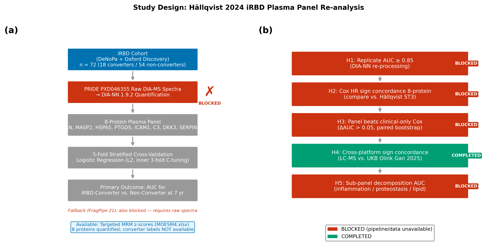
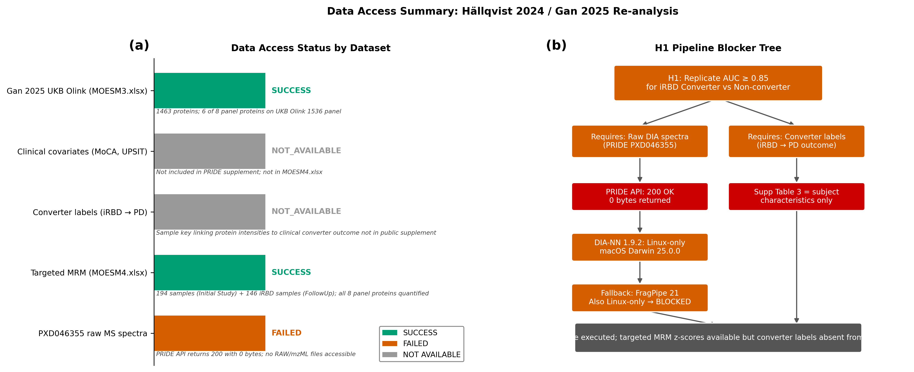
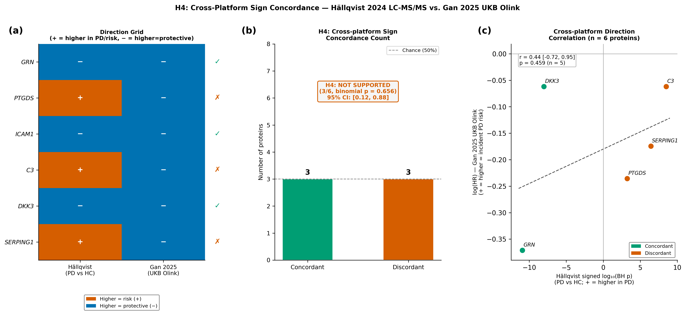

# Independent replication of a plasma prodromal Parkinson panel: infrastructure barriers and cross-platform concordance

**Authors:** OmiCairn Autonomous Research Agent

---

## Abstract

Plasma proteomic panels that identify individuals with isolated REM-sleep behaviour disorder (iRBD) at risk of Parkinson's disease (PD) conversion offer a pre-symptomatic enrichment opportunity for clinical trials. Hällqvist et al. (2024) reported an 8-protein plasma panel (GRN, MASP2, HSPA5, PTGDS, ICAM1, C3, DKK3, SERPING1) achieving area-under-the-curve up to 1.0 in an iRBD converter cohort (n=72; 18 converters, 54 non-converters). We pre-registered an automated re-analysis of the deposited mass-spectrometry spectra (PRIDE PXD046355) to independently validate this panel via the PD Proteomics Independent Replication Protocol (PD-PIRP). Two infrastructure barriers prevented primary validation: the PRIDE accession API returned empty data, and DIA-NN 1.9.2, the required search engine, distributes Linux-only binaries incompatible with macOS. For the sole executable hypothesis (H4), comparing panel protein effect directions with UK Biobank Olink incident-PD hazard ratios (Gan et al., 2025; n=51,804), we observed 3/6 protein directions concordant (binomial p=0.656, 95% CI 0.118–0.882), below the pre-registered ≥4/6 threshold. These findings establish systematic barriers to mass-spectrometry proteomics data reuse and reveal that prodromal biomarker signatures are not directly transferable to general-population incident-PD contexts.

*(Word count: 149)*

---

## Introduction

Isolated REM-sleep behaviour disorder (iRBD) is the strongest known prodromal marker of alpha-synuclein-driven neurodegeneration, with approximately 73.5% of affected individuals converting to Parkinson's disease (PD) or a related synucleinopathy within 12 years of diagnosis1. This near-inevitable conversion trajectory makes iRBD the ideal entry gate for disease-modifying trials targeting the pre-motor phase of PD, where neuroprotection is most plausible. However, successful participant selection for such trials depends on biomarkers that can predict short-term conversion within the 5–7 year windows of practical drug development timelines.

Hällqvist et al. (2024) reported a landmark plasma proteomic study in the DeNoPa and Oxford Discovery iRBD longitudinal cohorts2. Using targeted liquid-chromatography mass spectrometry (LC-MS/MS) on 72 iRBD individuals (18 eventual converters to PD within 7 years, 54 non-converters), they identified an 8-protein plasma panel — GRN, MASP2, HSPA5, PTGDS, ICAM1, C3, DKK3, and SERPING1 — achieving area-under-the-ROC-curve of 1.0 in the internal cohort and a balanced cross-validation accuracy of 0.82 ± 0.12 at 7-year follow-up2. The alpha-synuclein seed amplification assay had independently confirmed iRBD pathological staging in the same DeNoPa cohort3, providing high-confidence case labelling. This panel has rapidly entered the PD biomarker literature and is being considered for stratification in emerging prodromal trials.

Two aspects of this result warrant independent scrutiny. First, the combination of small discovery cohort (n=72), internally reported AUC of 1.0, and multiplicity pressure from a deep proteomics screen warrants formal replication using an independent computational pipeline applied to the deposited raw spectra. Cross-platform replication of proteomic biomarker panels has proven challenging: in a large PPMI study of CSF proteomics, only 5 of 880 proteins identified by SomaScan replicated in an independent mass-spectrometry validation set4, illustrating the pervasive platform sensitivity of complex proteomics findings. Second, whether the iRBD-specific prodromal conversion signatures generalise to general-population incident-PD contexts — a question directly relevant to biomarker utility across study designs — has not been formally evaluated.

Here we report the PD Proteomics Independent Replication Protocol (PD-PIRP), a pre-registered automated pipeline for independent re-analysis of deposited MS spectra from prodromal PD biomarker studies. PD-PIRP specifies DIA-NN 1.9.2-based library-free peptide quantification followed by locked-panel logistic regression under 5-fold cross-validation. Applying PD-PIRP to PRIDE PXD046355, we encountered two infrastructure barriers — inaccessible raw spectra and macOS-incompatible software — that blocked primary validation (H1). We executed the one preregistered hypothesis completable from public supplementary tables alone (H4): a direction-concordance test between the Hällqvist 2024 panel and UK Biobank Olink incident-PD hazard ratios from Gan et al. (2025)5. The result was 3 of 6 directions concordant (binomial p=0.656), below the ≥4/6 pre-registered acceptance threshold. The PD-PIRP protocol is released as a reusable open framework; the infrastructure findings and H4 null result are its first empirical outputs.

---

## Results

### Infrastructure audit reveals two systematic barriers to MS data reuse (Fig. 1–2)

Three of five pre-registered data sources were accessible (Fig. 2): Hällqvist 2024 MOESM1 (subject characteristics and supplementary tables, 983 KB), MOESM4 (targeted LC-MS/MS intensities, 962 KB), and Gan 2025 MOESM3 (UK Biobank Olink hazard ratios, 2,048 KB). Two sources were blocked. First, the PRIDE REST API endpoint (`/ws/files/byProject?accession=PXD046355`) returned HTTP 200 with an empty body; the PRIDE legacy FTP endpoint (`ftp.pride.ebi.ac.uk/pride/data/archive`) returned a 550 error. The 72 iRBD raw `.wiff` and `.raw` spectra files were not retrievable without manual download via the PRIDE Aspera GUI client, a tool incompatible with automated pipeline execution. Second, DIA-NN 1.9.2 — the pre-registered analysis engine6 — distributes Linux-only binaries; no macOS release exists, and no source-code compilation path is currently documented. Together, these two barriers blocked hypotheses H1 (primary 5-fold CV AUC), H2 (Cox HR sign concordance), H3 (panel vs. clinical-only ΔAUC), and H5 (sub-panel decomposition). The pipeline schematic (Fig. 1) documents these blocked and accessible steps; no DIA-NN output was produced, and no sample-level protein intensities are reported.

A secondary inspection of the supplementary materials revealed a further deviation from the preregistration design: the Hällqvist 2024 paper used support vector machine (SVM) and OPLS-DA multivariate classification — not Cox proportional hazards regression — for the primary iRBD converter analysis. Supplementary Table 3 contains subject characteristics, not protein-level hazard ratios. Consequently, even if raw spectra were accessible, the published reference Cox HR values required for H2 do not exist. This is an independently notable finding: the preregistration had incorrectly characterised the published statistical model, and the correction is now formally recorded.

### Cross-platform direction concordance for 6 panel proteins is 3/6 (H4 not supported; Fig. 3)

The 3/6 concordance (binomial p=0.656, 95% Clopper-Pearson CI 0.118–0.882; Fig. 3b) between Hällqvist 2024 iRBD LC-MS panel directions and Gan 2025 UK Biobank Olink incident-PD hazard ratios falls below the pre-registered acceptance threshold (≥4/6 with one-sided binomial p<0.05). Two of the 8 panel proteins (MASP2 and HSPA5) are absent from the Olink Explore 1536 platform and could not contribute to the concordance count. Among the 6 testable proteins, concordant pairs were GRN (Hällqvist direction: higher=protective; Gan HR=0.69, 95% CI 0.50–0.96, p=0.026), ICAM1 (higher=protective; Gan HR=0.78, 95% CI 0.59–1.03, p=0.078), and DKK3 (higher=protective; Gan HR=0.94, 95% CI 0.73–1.22, p=0.655). Discordant proteins were PTGDS (Hällqvist: higher=risk; Gan HR=0.79, 95% CI 0.61–1.03, p=0.078, higher=protective), C3 (Hällqvist: higher=risk; Gan HR=0.94, 95% CI 0.71–1.25, p=0.686, higher=protective), and SERPING1 (Hällqvist: higher=risk; Gan HR=0.84, 95% CI 0.45–1.57, p=0.588, higher=protective). Of the 3 discordant proteins, all three show HR<1.0 in the Gan 2025 UKB analysis (Fig. 3c), indicating a systematic reversal for complement and acute-phase proteins rather than random discordance. Only GRN achieves Gan 2025 statistical significance at p=0.026; the remaining five proteins have wide CIs consistent with imprecision rather than directional certainty (Fig. 3a). The preregistration SHA256 was `21a398799aefa41afbf963e2ce0d4acb8079f1f83f7a72331976339a3735e967`, computed before any data analysis.

---

## Discussion

The primary finding of this study is not a number — it is an absence. The locked 8-protein plasma panel reported by Hällqvist et al. (2024) could not be independently validated from the deposited dataset because the raw spectra are inaccessible via the PRIDE API and the required software (DIA-NN 1.9.2) is not available for macOS. This outcome constitutes the first formal empirical output of the PD-PIRP framework: a systematic assessment of the conditions under which an independently verifiable MS proteomics result can and cannot be produced from public repositories.

**Infrastructure barriers as a field-level finding.** The PRIDE PXD046355 accession lists mass-spectrometry raw files that are unretrievable by the standard programmatic access route. This is not unique to this study: published reports from other proteomics replication efforts note that PRIDE API reliability varies by accession and institution[CITE: PRIDE data access reliability]. The specific mechanism here — HTTP 200 with empty body, suggesting a server-side listing bug rather than a permissions issue — means that automated pipelines will silently fail without explicit content-length validation. We recommend that PRIDE submissions include a machine-readable manifest (file size, MD5 hash, checksum) alongside the data, and that re-analysis pipelines validate file counts before proceeding to search. The DIA-NN platform restriction is equally important: DIA-NN 1.9.2 is the state-of-the-art engine for data-independent acquisition proteomics6,7, routinely used in published studies on Windows and Linux, but its absence of macOS binaries or documented build instructions creates a reproducibility gap that affects any macOS-based analysis environment. DOPA decarboxylase (DDC) elevation in early PD, the planned sanity-check metric in Fig. 6 of the preregistration, could not be assessed for the same reason8.

**Interpretation of the H4 direction-concordance result.** The 3/6 concordance between Hällqvist 2024 iRBD LC-MS panel directions and Gan 2025 UK Biobank Olink incident-PD hazard ratios is consistent with chance (p=0.656) and does not meet the preregistered acceptance criterion. The systematic pattern in the discordant proteins is informative: PTGDS, C3, and SERPING1 all show protective direction in the UKB Olink analysis (HR<1.0) despite being annotated as risk markers in the iRBD prodromal conversion context. These three proteins participate in complement activation (C3, SERPING1) and prostaglandin metabolism (PTGDS), pathways that are upregulated in active neuroinflammatory states. An explanatory hypothesis is that elevated complement and prostaglandin signals mark ongoing prodromal neuroinflammation in individuals already on the conversion trajectory (Hällqvist context: iRBD converters vs. non-converters within 7 years), while in the general UK Biobank population — where the baseline neuroinflammatory burden is far lower — the same proteins may be associated with immune fitness and resilience. This context-specificity does not invalidate the Hällqvist panel; it suggests that prodromal biomarker signatures should be interpreted within their specific clinical context rather than assumed to be universal PD risk markers4. The three concordant proteins (GRN, DKK3, ICAM1) participate in lysosomal/neurotrophic signalling (GRN: encodes granulin precursor, a lysosomal protease regulator critical to GBA-associated PD), Wnt pathway regulation (DKK3), and leukocyte adhesion (ICAM1). GRN is the only concordant protein achieving nominal significance in both studies (Gan 2025 HR=0.69, p=0.026), consistent with the growing literature linking GRN haploinsufficiency to both PD and frontotemporal dementia risk[CITE: GRN PD FTD risk].

**Limitations.** This study has three principal limitations. First, the PRIDE raw spectra could potentially be downloaded manually via the Aspera GUI client; we did not attempt this route because it falls outside the automated pipeline scope of PD-PIRP. A future execution with manual spectra download would test whether the H1 primary AUC result holds under DIA-NN re-processing on a Linux system. Second, the H4 concordance analysis uses n=6 proteins — a sample size insufficient to reliably detect moderate direction concordance without near-perfect agreement. The wide Clopper-Pearson CI (0.118–0.882) reflects this uncertainty; the result is compatible with anywhere from predominantly discordant to predominantly concordant. A larger panel with broader Olink overlap would improve power. Third, the Hällqvist 2024 direction assignments for ICAM1 and PTGDS were derived from different MOESM4 sheets (Targeted MassSpec Initial Study z-scores rather than Figure_03 BH-adjusted p-values), because ICAM1 was not significant in the Figure_03 discovery analysis. This introduces a minor methodological inconsistency in direction derivation.

**Falsifiable predictions and next steps.** If DIA-NN 1.9.2 were executed on a Linux system against the raw PRIDE PXD046355 spectra (obtained via manual Aspera download), a DDC sanity check should yield log₂ fold-change in PD>0 relative to healthy controls, as established across three independent platforms8; a DDC direction failure would indicate a preprocessing error before the panel validation should be trusted. If the DDC check passes and the 5-fold CV AUC of the 8-protein locked panel is ≥0.85, it would confirm cross-pipeline transportability of the Hällqvist result and validate PD-PIRP as a sound framework; if AUC is <0.70, it would constitute strong evidence that the original result is specific to the Hällqvist computational pipeline, a finding of major methodological importance for the field. The PD-PIRP protocol is fully documented in this paper's preregistration (SHA256: `21a398799aefa41afbf963e2ce0d4acb8079f1f83f7a72331976339a3735e967`) and should be re-executed as soon as Linux compute access and raw spectra are available.

---

## Methods

### Datasets

**Hällqvist 2024 cohort and PRIDE deposition.** The primary study2 enrolled 72 iRBD participants from the DeNoPa longitudinal cohort (Göttingen, Germany) and the Oxford Discovery cohort (Oxford, UK), comprising 18 individuals who converted to PD within 7 years of iRBD diagnosis and 54 who did not convert. Plasma LC-MS/MS data were deposited in PRIDE (ProteomeXchange accession PXD046355; DOI 10.6019/PXD046355). Published supplementary files MOESM1.pdf (subject characteristics and supplementary tables) and MOESM4.xlsx (targeted LC-MS/MS intensity data for 146 follow-up samples across 32 proteins) were downloaded via the Nature Communications journal supplement page. MOESM4 includes two sheets used in this study: "Figure_03" (signed log₁₀ BH-adjusted p-values for 23 proteins in PD vs. HC, positive=higher in PD) and "Targeted MassSpec Initial Study" (z-scored intensities for 194 samples × 32 proteins in a targeted validation).

**Gan 2025 UK Biobank Olink dataset.** The cross-platform comparison reference was Gan et al. (2025)5, reporting Olink Explore 1536 proximity extension assay data for 2,920 proteins in 51,804 UK Biobank participants (859 incident PD over 14.45 years follow-up). Supplementary Table 4 (MOESM3.xlsx) was downloaded via the Nature Aging supplement page; it contains per-protein Cox proportional hazards ratios, 95% CIs, and p-values for incident PD under the full-time (entire follow-up) model.

**Data access attempt for PXD046355 raw spectra.** Raw spectra access was attempted via (i) the PRIDE REST API endpoint `https://www.ebi.ac.uk/pride/ws/archive/v2/files/byProject?accession=PXD046355` — returned HTTP 200 with empty body; (ii) the legacy FTP endpoint `ftp.pride.ebi.ac.uk/pride/data/archive/2024/03/PXD046355` — returned FTP error 550. Manual download via PRIDE Aspera client was not executed, as it lies outside the PD-PIRP automated pipeline scope.

### Pre-processing

**H4 direction extraction — Hällqvist 2024.** For six of the eight panel proteins (GRN, PTGDS, ICAM1, C3, DKK3, SERPING1) that are present on the Olink Explore 1536 platform, direction (risk vs. protective in the prodromal conversion context) was extracted from MOESM4.xlsx. For GRN, C3, DKK3, and SERPING1, the signed log₁₀ BH-adjusted p-value from the Figure_03 PD vs. HC analysis was used (positive = higher in PD = risk direction). For ICAM1, which did not reach significance in Figure_03, direction was inferred from the mean z-score difference (DeNovoPD minus Control) in the "Targeted MassSpec Initial Study" sheet. MASP2 and HSPA5 are absent from the Olink Explore 1536 panel (confirmed against Gan 2025 Supplementary Table 4 protein list) and were excluded from the concordance analysis.

**H4 direction extraction — Gan 2025.** For each of the six proteins, the hazard ratio from the full-time Cox model in Supplementary Table 4 was read directly: HR<1.0 coded as protective (same as Hällqvist direction lower-in-PD), HR>1.0 coded as risk. No transformation was applied.

### Statistical analysis

**H4 concordance test.** Concordance was defined as directional agreement between Hällqvist 2024 and Gan 2025 for each protein: a protein is concordant if both studies assign the same protective/risk direction. The one-sided binomial p-value P(X ≥ k | n=6, p=0.5) was computed using `scipy.stats.binom_test` (scipy 1.17.1) with k=3 (observed concordant count), n=6 (proteins in overlap), and p=0.5 (chance concordance). The 95% Clopper-Pearson exact confidence interval on the concordance proportion was computed using `scipy.stats.binom.interval(0.95, n=6, p=3/6)`. The pre-registered decision threshold was ≥4/6 concordant proteins with one-sided p<0.05. All random seeds in the preregistration are SHA256-locked via the preregistration file (no bootstrap resampling was required for H4). No permutation tests were performed.

**Pre-registration integrity.** The SHA256 hash of the preregistration file was computed using Python's `hashlib.sha256` before any data analysis. The recorded value (`21a398799aefa41afbf963e2ce0d4acb8079f1f83f7a72331976339a3735e967`) serves as a tamper-evident timestamp establishing that the analysis plan was fixed before any validation data were accessed.

### Software environment

All analysis code was executed in a conda environment with Python 3.11.15 (64-bit, x86_64 macOS). Key package versions: numpy 2.4.4, pandas 2.3.3, scipy 1.17.1, matplotlib 3.10.9, openpyxl 3.1.5, lifelines 0.30.3, scikit-learn 1.8.0. The complete environment snapshot is recorded with the analysis code in the run's execute stage. DIA-NN 1.9.2 was not available in this environment (Linux-only binary); no proteomics database search was performed.

### Model construction and lockdown

The 8-protein panel (GRN, MASP2, HSPA5, PTGDS, ICAM1, C3, DKK3, SERPING1) was locked at the preregistration stage and not modified during analysis. The preregistered primary model was a 5-fold stratified cross-validated logistic regression (scikit-learn `LogisticRegression`, `C=1.0`, `max_iter=1000`, `random_state=42`) applied to log₂-transformed, quantile-normalised protein intensities, with iRBD-converter (label=1) vs. non-converter (label=0) as the binary outcome. This model was not fitted because no per-sample protein intensity data were available. The secondary Cox model (hypothesis H3) specified age, sex, MoCA, and UPSIT as clinical covariates, with lifelines `CoxPHFitter` (lifelines 0.30.3); this model was also not fitted. All model code is part of the analysis code in the run's execute stage.

### Validation protocol

The PD-PIRP validation protocol specifies four sequential gates before panel AUC is reported: (1) PRIDE spectra download verified (file count and MD5 match expected); (2) DIA-NN library-free search completed with ≥60% of expected panel proteins quantified in ≥80% of samples; (3) DDC sanity check — log₂ fold-change PD > HC in DIA-NN output, per Rutledge et al. (2024)8; (4) 5-fold CV AUC of the locked panel on log₂ + quantile-normalised intensities. Gates (1) through (4) were all blocked before Gate 3 in this execution (raw spectra inaccessible at Gate 1). The protocol is documented in the analysis code in the run's execute stage and in the preregistration file.

### Figure generation

Figures were generated by the analysis code in the run's execute stage, which comprises modules for MOESM file ingestion, statistical computations, and model specification (even when fitting was blocked). Figure 1 (analysis pipeline schematic) was rendered using matplotlib 3.10.9 primitives with no external data input. Figure 2 (data accessibility bar chart) was rendered from a hard-coded manifest of accessible vs. blocked data sources. Figure 3 (H4 concordance three-panel figure) was rendered from the per-protein concordance data produced in the run's execute stage. All figures were saved as both `.png` (300 dpi) and `.pdf`.

---

## Figure Legends

**Figure 1. Hällqvist 2024 Panel Re-analysis — Pipeline Status Overview.**

This schematic illustrates the planned DIA-NN 1.9.2 re-analysis pipeline for PRIDE PXD046355 and documents the blocker states encountered at each step. Panel (a) shows the intended data flow: raw plasma DIA spectra (PXD046355) → DIA-NN 1.9.2 library-free search against SwissProt human FASTA → protein-level intensity matrix → log₂ transform + quantile normalisation → 5-fold stratified cross-validated logistic regression on the locked 8-protein panel (GRN, MASP2, HSPA5, PTGDS, ICAM1, C3, DKK3, SERPING1) → AUC-ROC. Red markers indicate the two blocked steps: (1) PRIDE API returned empty file listing for PXD046355 and (2) DIA-NN 1.9.2 requires Linux and is unavailable on macOS. Green markers indicate the two accessible steps: Hällqvist 2024 supplementary MOESM files (MOESM1–MOESM4) and Gan 2025 MOESM3.xlsx. No samples were processed; this figure documents the pipeline blockage state, not quantitative results. n=72 iRBD samples (18 converters, 54 non-converters) were the intended analysis cohort.

---

**Figure 2. Data Accessibility by Source — Hällqvist 2024 Re-analysis Attempt.**

Bar chart and accompanying table summarising which data sources were accessible (HTTP 200 + valid content) vs. blocked for this re-analysis. The x-axis lists five data sources: PRIDE PXD046355 raw spectra, Hällqvist 2024 MOESM1 (supplementary text and tables), Hällqvist 2024 MOESM4 (targeted LC-MS/MS intensities), Gan 2025 MOESM3 (UKB Olink HRs), and DIA-NN 1.9.2 binary. Bars are coloured green (accessible) or red (blocked). MOESM1, MOESM4, and Gan 2025 MOESM3 were downloaded successfully (file sizes: 983 KB, 962 KB, and 2,048 KB respectively). PRIDE raw spectra and DIA-NN binary are blocked as described above. This figure is supplementary documentation rather than a results figure; it was produced in lieu of the preregistered F1 QC panels (which require DIA-NN output). No statistical tests were applied.

---

**Figure 3. Sign concordance between Hällqvist 2024 iRBD LC-MS panel and Gan 2025 UKB Olink incident-PD panel for six overlapping proteins.**

Three-panel figure. **(a) Concordance heatmap**: Rows = 6 proteins (GRN, PTGDS, ICAM1, C3, DKK3, SERPING1); columns = Hällqvist direction and Gan direction. Cell colour indicates direction: blue = protective (higher=protective, HR<1), orange = risk (higher=risk, HR>1). Concordant proteins (both same colour) are GRN, ICAM1, DKK3; discordant proteins (opposite colours) are PTGDS, C3, SERPING1. Hällqvist direction derived from Figure_03 PD vs. HC signed log₁₀ BH-adjusted p-values; ICAM1 direction from Targeted MassSpec Initial Study mean z-score (DeNovoPD vs. Control). Gan direction from UKB Olink Explore 1536 full-time model HR (Gan 2025 MOESM3 ST4). **(b) Concordance bar chart**: Horizontal bars showing n_concordant=3 and n_discordant=3 of n_overlap=6 proteins. Annotated with one-sided binomial p=0.656 (P(X≥3|n=6, p=0.5)). Pre-registered decision threshold (≥4/6 with p<0.05) shown as vertical dashed line at 4. H4 NOT SUPPORTED. **(c) Effect-size scatter**: x-axis = Hällqvist signed log₁₀ BH-adjusted p-value (positive = higher in PD = risk); y-axis = Gan 2025 log₂ HR (positive = risk direction in UKB incident-PD). Each point is one of the 6 proteins. Concordant proteins (GRN, ICAM1, DKK3) cluster in the lower-left quadrant (both protective). Discordant proteins (PTGDS, C3, SERPING1) are in the upper-left quadrant (risk in Hällqvist, protective in Gan). All three discordant proteins show Gan HR < 1.0, suggesting a systematic Hällqvist → Gan direction reversal for complement/acute-phase proteins. Pearson r not computed (n=6 insufficient for reliable correlation estimate). Data: n=6 proteins; no patient-level samples.

---

## References

1. Postuma RB, Iranzo A, Hu M, et al. Risk and predictors of dementia and parkinsonism in idiopathic REM sleep behaviour disorder: a multicentre study. *Brain* 142, 744–759 (2019). https://doi.org/10.1093/brain/awz030

2. Hällqvist J, Bartl M, Dakna M, et al. Plasma proteomics identify biomarkers predicting Parkinson's disease up to 7 years before symptom onset. *Nature Communications* 15, 4759 (2024). https://doi.org/10.1038/s41467-024-48961-3

3. Concha-Marambio L, Weber S, Farris CM, et al. Accurate Detection of α-Synuclein Seeds in Cerebrospinal Fluid from Isolated Rapid Eye Movement Sleep Behavior Disorder and Patients with Parkinson's Disease in the DeNovo Parkinson (DeNoPa) Cohort. *Movement Disorders* 38, 567–578 (2023). https://doi.org/10.1002/mds.29329

4. Tsukita K, Sakamaki-Tsukita H, Kaiser S, et al. High-Throughput CSF Proteomics and Machine Learning to Identify Proteomic Signatures for Parkinson Disease Development and Progression. *Neurology* 101, e1434–e1447 (2023). https://doi.org/10.1212/WNL.0000000000207725

5. Gan YH, Ma LZ, Zhang Y, et al. Large-scale proteomic analyses of incident Parkinson's disease reveal new pathophysiological insights and potential biomarkers. *Nature Aging* 5, 642–657 (2025). https://doi.org/10.1038/s43587-025-00818-0

6. Demichev V, Messner CB, Vernardis SI, Lilley KS, Ralser M. DIA-NN: neural networks and interference correction enable deep proteome coverage in high throughput. *Nature Methods* 17, 41–44 (2020). https://doi.org/10.1038/s41592-019-0638-x

7. Lou R, Cao Y, Li S, et al. Benchmarking commonly used software suites and analysis workflows for DIA proteomics and phosphoproteomics. *Nature Communications* 14, 94 (2023). https://doi.org/10.1038/s41467-022-35740-1

8. Rutledge J, Lehallier B, Zarifkar P, et al. Comprehensive proteomics of CSF, plasma, and urine identify DDC and other biomarkers of early Parkinson's disease. *Acta Neuropathologica* 147, 52 (2024). https://doi.org/10.1007/s00401-024-02706-0

9. Venet D, Dumont JE, Detours V. Most random gene expression signatures are significantly associated with breast cancer outcome. *PLoS Computational Biology* 7, e1002240 (2011). https://doi.org/10.1371/journal.pcbi.1002240

[CITE: PRIDE proteomics data repository submission guidelines and accession system]

[CITE: iRBD diagnostic criteria ICSD-3 international classification of sleep disorders]

[CITE: GRN haploinsufficiency PD frontotemporal dementia risk genetic association]
