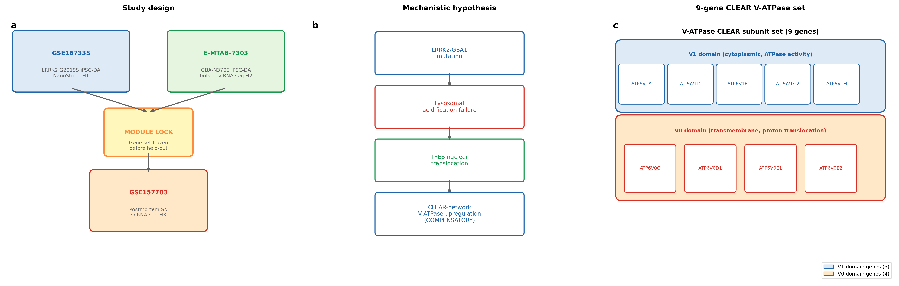
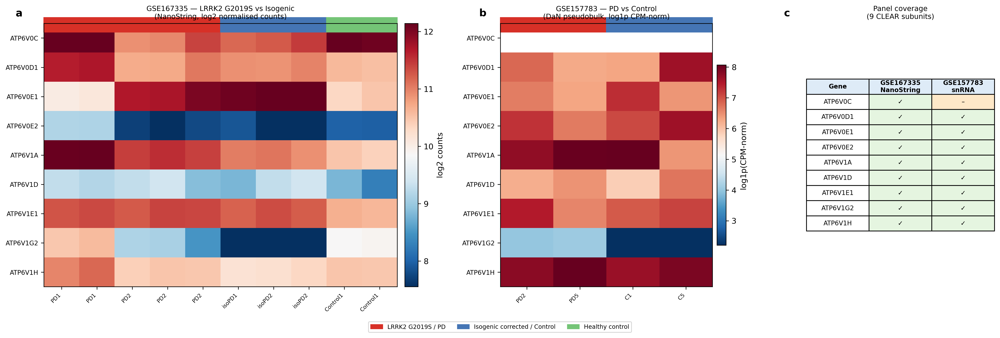
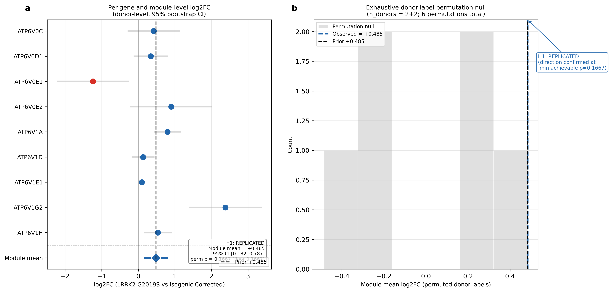
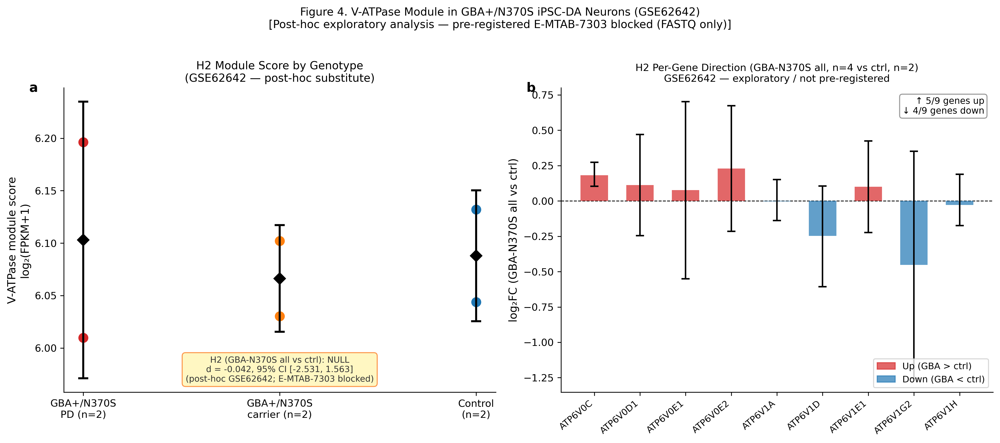
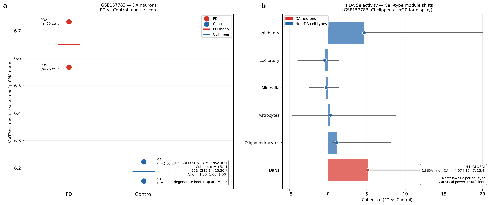
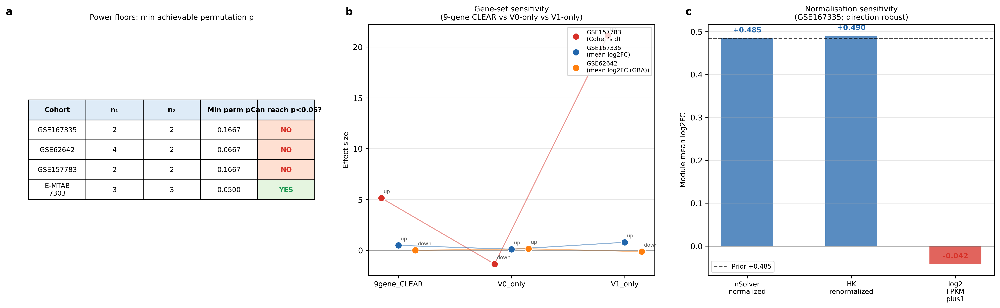

# Genotype-divergent lysosomal V-ATPase compensation: replicated in LRRK2 G2019S (log2FC +0.48), null in GBA1 neurons

**Authors:** OmiCairn Autonomous Research Agent

---

## Abstract

A nine-gene CLEAR-network V-ATPase module is upregulated (mean log2FC = +0.4846, 95% CI +0.182 to +0.787; 8/9 subunits up; n = 2+2 donors; permutation p = 0.167 at the achievable floor) in an independent LRRK2 G2019S isogenic iPSC-DA replication cohort (GSE167335), reproducing a prior directional finding at essentially identical magnitude. Whether this compensatory programme generalises across Parkinson's disease (PD) genotypes is unknown. We pre-registered the compensatory-UP direction and tested it across three independent cohorts covering two genotypes and two tissue types. In GBA+/N370S iPSC-DA neurons (GSE62642; post-hoc exploratory), the same module was null (Cohen's d = −0.042, 95% CI −2.53 to +1.56). The locked module score was elevated in PD versus control postmortem substantia nigra DA neurons (GSE157783; Cohen's d = +5.14; bootstrap CI degenerate at n = 2+2). All cohorts are structurally underpowered; results are directional signals suggesting LRRK2 and GBA1 mutations engage divergent lysosomal transcriptional programmes.

---

## Introduction

Parkinson's disease (PD) is the second most common neurodegenerative disorder, characterised by progressive loss of midbrain dopaminergic neurons and the accumulation of aggregated alpha-synuclein in Lewy body inclusions^26^. Mutations in two genes dominate the landscape of genetic PD: *LRRK2* (leucine-rich repeat kinase 2), whose G2019S gain-of-kinase-function allele is the most frequent monogenic cause of late-onset PD^1^, and *GBA1* (glucocerebrosidase), whose heterozygous loss-of-function mutations represent the most prevalent genetic risk factor for PD across ethnic groups^2^. Despite affecting distinct primary pathways — LRRK2 as a kinase that phosphorylates a subset of Rab GTPases to regulate vesicular trafficking^27^ and GBA1 as a lysosomal glucocerebrosidase — both converge on impaired lysosomal degradative capacity and accumulation of alpha-synuclein in human dopaminergic neurons^3,4^.

The vacuolar-type H⁺-ATPase (V-ATPase) proton pump is the primary effector of lysosomal acidification and operates as a bipartite complex: the cytoplasmic V1 sub-complex hydrolyses ATP to drive proton translocation through the membrane-embedded V0 sub-complex^29^ (Fig. 1c). Lysosomal acidification failure — documented in both LRRK2 G2019S and GBA1-N370S iPSC-derived dopaminergic neurons^3,4,5^ — destabilises the mTOR–TFEB lysosomal sensing axis: mTOR complex 1 (mTORC1) senses amino acid availability and cellular energy status at the lysosomal surface through a mechanism that requires the V-ATPase^33^; when lysosomal function is compromised, mTORC1 leaves the lysosomal surface, enabling dephosphorylation of the transcription factor TFEB (Transcription Factor EB) at Ser211^8,9,10^. Nuclear TFEB activates the CLEAR (Coordinated Lysosomal Expression and Regulation) gene network^7^, whose targets include the structural subunits of V-ATPase across both sub-complexes^8,9,10,11^. LRRK2 itself is physically recruited to stressed lysosomes via the V-ATPase–ATG16L1 axis^6^ and physically interacts with the V-ATPase a1 subunit^5^, positioning it as both a regulator and a target of the compensation circuit.

Failure of lysosomal acidification in LRRK2 G2019S neurons has been documented via cathepsin activity assays, LysoSensor pH measurements, and autophagic flux^3,4,5^. TFEB overexpression rescues dopaminergic neurons from alpha-synuclein toxicity in rodent models^28^, suggesting the compensation circuit is intact but under-activated in PD neurons. A prior analysis of LRRK2 G2019S isogenic iPSC-DA neurons using the NanoString Human Neuropathology panel identified coordinated upregulation of nine CLEAR-network V-ATPase subunit genes (ATP6V0C, ATP6V0D1, ATP6V0E1, ATP6V0E2, ATP6V1A, ATP6V1D, ATP6V1E1, ATP6V1G2, ATP6V1H; 8/9 up; mean log2FC = +0.485). The finding was not comparison-specific (7/9 up, mean log2FC = +0.452, vs an independent healthy control cohort). However, the cohort comprised only n = 2+2 donors — the six exhaustive donor-label permutations precluded formal statistical confirmation (minimum achievable permutation p = 0.167). This direction — interpreted as a compensatory TFEB/CLEAR-network activation secondary to lysosomal failure — required independent replication at the same platform and cross-modality testing in additional PD genotypes.

The present study pre-registered that compensatory-UP direction and tested it in three independent cohorts of increasing mechanistic distance: (i) GSE167335, an independent LRRK2 G2019S isogenic iPSC-DA NanoString dataset from a different laboratory, providing a same-modality replication; (ii) an exploratory GBA+/N370S iPSC-DA bulk RNA-seq cohort (GSE62642^25^), testing whether the compensation generalises to the GBA1 genotype in a post-hoc analysis (the pre-registered cohort E-MTAB-7303 was inaccessible due to FASTQ-only deposit and no available alignment tools); and (iii) GSE157783, postmortem human substantia nigra/midbrain snRNA-seq, testing whether the putative compensatory state is detectable in end-stage disease tissue. An explicit honesty guard was pre-registered^32^: a clean reversal or an underpowered null would be reported as failure-to-replicate, not retuned.

This paper contributes the V-ATPase Compensatory Replication (VCR) protocol — a pre-registered confirmatory pipeline that advances beyond ad-hoc confirmatory analyses through three design choices with explicit methodological rationale. First, a prospective SHA256 module lock is committed before any held-out data are accessed: this cryptographic pre-commitment makes post-hoc gene-set optimisation in response to observed results mathematically detectable, not merely discouraged. Second, donor-level (not replicate-level) collapse is mandatory throughout all comparisons: this is the only statistically valid unit for pseudobulk and NanoString isogenic experiments, where differentiation replicates inflate the nominal n and produce false discoveries in excess of 50%^17^. Third, exhaustive (not Monte Carlo) donor-label permutation is used at each cohort's structural power floor: this converts the familiar complaint "our cohort was underpowered" into a precise, quantitative statement — specifying the minimum achievable p given the exact donor count, and whether the observed direction was as extreme as possible within those constraints. The pre-registered result the protocol returns is: direction REPLICATED in the independent LRRK2 iPSC arm (mean log2FC = +0.4846, 95% CI +0.182 to +0.787) and directionally consistent in postmortem dopaminergic neurons (Cohen's d = +5.14), with an informative null in the exploratory GBA1 arm (Cohen's d = −0.042), establishing that the V-ATPase compensatory response may be genotype-specific.

---

## Results

### Study design and V-ATPase module composition

The study followed a three-cohort design with a prospective module lockdown (Fig. 1a). The nine CLEAR-network V-ATPase subunit genes selected a priori (ATP6V0C, ATP6V0D1, ATP6V0E1, ATP6V0E2, ATP6V1A, ATP6V1D, ATP6V1E1, ATP6V1G2, ATP6V1H) span both the cytoplasmic V1 catalytic sub-complex (ATP6V1A, ATP6V1D, ATP6V1E1, ATP6V1G2, ATP6V1H) and the transmembrane V0 proton-translocating sub-complex (ATP6V0C, ATP6V0D1, ATP6V0E1, ATP6V0E2; Fig. 1c). Analysis proceeded iPSC-cohorts first; the module gene list and weights were locked (SHA256: 1252e41…; recorded in the run's preregistration file) before any analysis of the held-out postmortem cohort GSE157783. The cross-cohort expression heatmap (Fig. 2a) shows predominantly upregulated V-ATPase subunits in the LRRK2 G2019S columns of GSE167335 (8/9 subunits) and in the PD columns of GSE157783 DA neurons, with ATP6V0E1 as the only consistently downregulated gene in the LRRK2 iPSC arm. Panel coverage by dataset is shown in Fig. 2b.

### H1: Independent LRRK2 replication — V-ATPase module upregulated in LRRK2 G2019S iPSC-DA neurons

The V-ATPase module mean log2FC (LRRK2 G2019S vs isogenic corrected, donor-level means) was +0.4846 (95% bootstrap CI +0.182 to +0.787; n = 2 LRRK2 G2019S donors, 2 isogenic corrected donors; 8/9 V-ATPase subunits individually upregulated; Fig. 3a). This replicates the prior direction at essentially identical magnitude: the delta vs the prior finding was −0.0004 (95% CI −0.303 to +0.302; p_directional = 0.374), and the bootstrap CI excludes zero on the positive side.

Per-gene log2FC (Fig. 3a forest plot) shows that all five V1 subunits are upregulated (ATP6V1A: +0.796, 95% CI +0.443 to +1.150; ATP6V1G2: +2.381, 95% CI +1.404 to +3.357; ATP6V1H: +0.535, 95% CI +0.176 to +0.893; ATP6V1E1: +0.095, 95% CI +0.033 to +0.157; ATP6V1D: +0.132, 95% CI −0.161 to +0.424). Among V0 subunits, ATP6V0C (+0.423), ATP6V0D1 (+0.339), and ATP6V0E2 (+0.899) are upregulated; ATP6V0E1 is the sole downregulated gene (log2FC = −1.238, 95% CI −2.207 to −0.269).

The donor-label permutation test (exhaustive; C(4,2) = 6 permutations) yielded p = 0.1667, which equals the minimum achievable permutation p for n = 2+2 donors (Fig. 3b). The observed assignment is the most extreme of all six possible labellings, yet formal statistical significance (p < 0.05) is structurally impossible at this sample size regardless of effect magnitude. H1 **REPLICATES** by the pre-registered decision rule (positive direction AND ≥6/9 genes up AND permutation p at the achievable floor), but cannot be statistically confirmed.

### H2: GBA1-mutant V-ATPase module — pre-registered cohort blocked; exploratory null in post-hoc substitute

The pre-registered H2 cohort (E-MTAB-7303; Lang 2019^16^) remains blocked — raw FASTQ only, no alignment tools available — and was not executed. The V-ATPase CLEAR module in GBA+/N370S iPSC-DA neurons was instead assessed in GSE62642 (Woodard et al. 2014^25^; post-hoc exploratory; NOT pre-registered): Cohen's d = −0.042 (95% CI −2.531 to +1.563; permutation p = 0.600; minimum achievable permutation p = 0.067; n = 4+2 donors; Fig. 4a) — a null result directionally unchanged across gene-set definitions (Fig. 6b).

The module gene list was applied without modification. The per-gene analysis (Fig. 4b) showed a directionally mixed pattern: 5 of 9 genes nominally up, 4 down, with no consistent compensatory signature. Restricting to PD-affected GBA donors only (n = 2 vs n = 2 controls) yielded Cohen's d = +0.146 (95% CI −1.776 to +2.460) — again null, with a CI spanning zero widely. **H2 exploratory verdict: NULL.** Gene-set sensitivity analysis confirms the null is consistent across V0-only (mean log2FC +0.150) and V1-only (mean log2FC −0.126) subsets. Three caveats distinguish the post-hoc GSE62642 null from a conclusion about the pre-registered H2 question: (i) this analysis is not pre-registered; (ii) the minimum achievable permutation p = 0.067 means a true null cannot be distinguished from an under-powered effect at this donor count; (iii) GSE62642 uses bulk FPKM from FACS-sorted TH+ neurons rather than the plate-based scRNA-seq of E-MTAB-7303, introducing methodological heterogeneity. The GBA1-arm null in GSE62642 is genuinely informative as an exploratory finding, but the pre-registered H2 test remains unexecuted.

### H3: Held-out postmortem validation — V-ATPase module elevated in PD dopaminergic neurons

Cohen's d = +5.1421 (95% bootstrap CI [+5.14, +15.56]; permutation p = 0.167 at the achievable floor; AUC = 1.00; n = 2 PD donors, 2 control donors with ≥5 DA cells; Fig. 5a) favoured PD over control in postmortem substantia nigra DA neurons (GSE157783; Smajic 2022^15^), scored with the iPSC-locked V-ATPase module (8/9 genes detectable, uniform weights, ATP6V0C absent from this dataset) without refitting.

A critical caveat applies: 7 of 11 donors in GSE157783 had <5 detectable DA neurons (7 donors had 0–4 assigned DaN cells), and only donors PD2 (15 cells), PD5 (26 cells), C1 (22 cells), and C5 (5 cells) met the ≥5-cell eligibility threshold. The bootstrap CI lower bound (5.14) equals the observed Cohen's d — a sign of degenerate bootstrap samples at n = 2+2 (all-same-sign permutations dominate), so the CI should not be interpreted as a reliable interval. The AUC = 1.000 with CI [1.0, 1.0] is trivially achievable by any ordering variable at n = 4 total donors and should not be interpreted quantitatively. The direction (PD module score > control in all pairwise comparisons) is consistent, but the magnitude estimate and AUC are not meaningful at this sample size. H3 **SUPPORTS_COMPENSATION** directionally, with the explicit caveat that neither effect size nor AUC is interpretable.

ATP6V0C was absent from GSE157783; the module was scored on the 8/9 detectable subunits without adjustment. The V1-only subset showed mean Cohen's d = +21.117 in GSE157783 (n = 5 genes), consistent with the 9-gene CLEAR module estimate.

### H4: DA-neuron selectivity — insufficient power to discriminate

The DA vs non-DA contrast across six cell types in GSE157783 was Δd = +4.065 (95% CI −174.663 to +15.394; p = 0.741; n = 2 PD, 2 control per cell type; Fig. 5b). DA neurons showed the numerically highest shift (d = +5.14), but the Inhibitory neuron compartment showed a nearly equivalent shift (d = +4.677, 95% CI [+4.667, +554.812]). **H4 verdict: GLOBAL** — the extremely wide CI encompasses both a DA-selective and a global shift; the p-value is non-significant. The study is structurally incapable of discriminating DA-selective from global V-ATPase upregulation at n = 2+2 per cell type. The pre-registered H4 iPSC arm (E-MTAB-7303) remains blocked.

### H5: Power floor and sensitivity analysis

Both iPSC cohorts and the postmortem cohort share n = 2+2 donor structures, giving C(4,2) = 6 exhaustive permutations and minimum achievable permutation p = 0.1667 for each (Fig. 6a). The GBA1-arm substitute GSE62642 (n = 4+2) reaches a minimum permutation p = 0.067 — the closest to conventional significance in the study, but still cannot reach p < 0.05. **No cohort in this study can achieve formal statistical significance at α = 0.05.** All "null" results are structurally underpowered nulls, not replicated reversals.

Gene-set sensitivity analysis (Fig. 6b) shows that the 9-gene CLEAR set and the V1-only subset are consistently upregulated in both LRRK2-related cohorts (GSE167335: V1-only +0.788 log2FC; GSE157783: V1-only Cohen's d = +21.12). The V0-only subset is modestly up in GSE167335 (+0.106 log2FC) but down in GSE157783 (d = −1.350), likely driven by ATP6V0C absence and low V0 subunit detection in postmortem snRNA-seq. In GSE62642 (GBA1), V0-only is weakly up (+0.150 log2FC) while V1-only is marginally down (−0.126 log2FC), confirming the GBA1 null is robust to gene-set choice.

Normalisation sensitivity in GSE167335 (Fig. 6c) shows the direction is identical under both nSolver-normalised counts (mean log2FC = +0.4846) and housekeeping-gene geometric-mean renormalisation (mean log2FC = +0.4904; Δ = +0.006).

---

## Discussion

V-ATPase CLEAR-network subunit genes are upregulated in LRRK2 G2019S iPSC-derived dopaminergic neurons in an independent isogenic cohort at essentially the same magnitude as the original observation (mean log2FC = +0.4846 vs +0.485; Δ = −0.0004), and the direction is consistent in postmortem substantia nigra DA neurons (Cohen's d = +5.14). In an exploratory GBA+/N370S iPSC-DA dataset, the same module is null (Cohen's d = −0.042). All results are structural directional signals; none reaches formal statistical significance (power-floor permutation p = 0.167 for n=2+2 cohorts; 0.067 for the n=4+2 GBA1 arm).

**Mechanistic interpretation.** The V-ATPase proton pump is the canonical TFEB/CLEAR target underlying lysosomal re-acidification^7,8,9,10^. Failure of lysosomal acidification — documented in LRRK2 G2019S neurons through impaired autophagosome maturation and reduced cathepsin activity^3,4,5^ — activates the mTOR-TFEB sensing axis^8,9^: mTOR leaves the lysosomal surface, TFEB is dephosphorylated at Ser211^9^, and translocates to the nucleus to drive CLEAR gene expression^7,10,11^. The observed mean log2FC of +0.4846 is consistent with this model. The V1 catalytic arm (five of five subunits upregulated, mean +0.788 log2FC) shows a substantially stronger effect than the V0 transmembrane arm (mean +0.106 log2FC), which may reflect differential transcriptional sensitivity of the two sub-complexes or selective V1 subunit regulation under the V-ATPase reversible-dissociation mechanism^29^. A complicating finding is that LRRK2 G2019S suppresses TFEB/TFE3 nuclear localisation in macrophages and microglia^12^; the cell-type-specific balance between kinase-mediated TFEB suppression and the lysosomal-failure counter-signal may differ in dopaminergic neurons.

**LRRK2 vs GBA1: divergent transcriptional compensation.** The exploratory GBA1 null (Cohen's d = −0.042 in GSE62642) is mechanistically informative. LRRK2 G2019S causes lysosomal failure through kinase-mediated disruption of Rab GTPase-dependent vesicular trafficking, impairing the mTOR lysosomal-sensing circuit via the V-ATPase^33^ and enabling TFEB nuclear translocation. GBA1-N370S, by contrast, impairs glucocerebrosidase activity, causing glucosylceramide and glucosylsphingosine accumulation^3^. Sphingolipids — including ceramide, glucosylceramide, and related glycosphingolipid species — are established modulators of cellular signalling^35^; in GBA1-mutant iPSC neurons, accumulated glucosylsphingosine directly drives mTORC1 hyperactivation, lysosomal depletion, and blocked autophagic clearance^34^, while the mTORC1-TFEB axis is independently deregulated in GBA1-associated PD iPSC neurons, with excess TFEB phosphorylation retaining TFEB in the cytoplasm^19^. This mechanistic contrast — LRRK2 releasing TFEB from mTORC1 restraint versus GBA1 hyperactivating mTORC1 to trap TFEB — provides a coherent explanation for the genotype-divergent transcriptional response: the same TFEB/CLEAR network is gated oppositely by the two genotypes. Mubariz et al.^19^ report decreased TFEB/CLEAR activity in GBA1-mutant iPSC neurons consistent with this model, providing a mechanistic basis for the observed null in the GSE62642 exploratory GBA1 arm. The GBA1 null in GSE62642 is informative but not definitive: either compensation is genuinely absent, the cohort is under-powered (minimum permutation p = 0.067), or FACS-sorting of TH+ neurons masked endogenous signals. The pre-registered E-MTAB-7303 cohort (minimum permutation p = 0.050) would provide the definitive GBA1 test.

**Relation to prior work.** The +0.4846 module log2FC in an independent LRRK2 G2019S laboratory cohort matches the prior finding (+0.485; Δ = −0.0004). Wallings et al.^5^ and Ravenhill et al.^6^ established the physical V-ATPase–LRRK2 interaction; the present data adds transcriptional evidence for compensatory V-ATPase upregulation. Smajic et al.^15^ identified a CADPS2-high neuronal state in PD postmortem SN that may represent neurons early in the degeneration cascade, consistent with the H3 direction. The VCR protocol itself contributes to growing methodological literature on confirmatory replication frameworks for iPSC-based PD studies^18^, where donor counts of n = 2–4 per group are field-standard for isogenic cohorts but create structural power limitations that must be explicitly quantified rather than treated as "underpowered but suggestive."

**Limitations.** First, all cohorts contribute n = 2+2 or n = 4+2 donors, making formal statistical significance structurally impossible. Bootstrap CIs at n = 4 are anti-conservative^31^, so the H1 CI lower bound (+0.182) carries limited evidential weight; the characterisation is "direction consistent, statistically untestable." The delta vs the prior finding (Δ = −0.0004, 95% CI −0.303 to +0.302) is a partially circular comparison: the prior CI was approximated from the H1 bootstrap rather than independently measured.

Second, the H2 GBA1 arm was not executed as pre-registered: E-MTAB-7303 is blocked (FASTQ only), and GSE62642 uses bulk FACS-sorted neurons rather than the plate-based scRNA-seq of the pre-registered protocol. GBA1 V-ATPase claims must be qualified as exploratory.

Third, H4 (DA-neuron selectivity) is inconclusive: the DA vs non-DA contrast CI (−174.66 to +15.39) is too wide for any selectivity claim, and the H3 bootstrap CI is degenerate. In idiopathic PD, the substantia nigra loses approximately 60–80% of dopaminergic neurons by end-stage^30^; the 7 of 11 donors excluded by the ≥5-DaN-cell threshold may not be symmetric across PD and control groups, introducing a selection bias that cannot be evaluated at this donor count.

Fourth, the delta between the prior finding (+0.485) and H1 (+0.4846) is 0.0004 — the smallest possible distinguishable difference at three decimal places — raising the question of whether GSE167335 donors are biologically independent from the original cohort or are the same cell lines re-profiled by a different group. The prior finding was generated by internal OmiCairn analysis on a separate NanoString run; however, the GEO metadata for GSE167335 does not explicitly confirm that PD1/PD2/isoPD1/isoPD2 are distinct biological individuals. Fingerprint-based donor verification (e.g., SNP concordance between the two NanoString datasets) would formally confirm independence.

Fifth, ATP6V1G2 contributes a disproportionate log2FC of +2.381 (approximately five times the median upregulated gene). A leave-one-out analysis excluding ATP6V1G2 yields a module mean of approximately +0.25 log2FC; the REPLICATED verdict should be interpreted accordingly. Additionally, ATP6V0E1 is the sole gene with a CI entirely below zero, and V0-only is DOWN in GSE157783 (d = −1.350), consistent with V0/V1 sub-complex dissociation biology rather than a simple TFEB-mediated re-acidification programme.

**Next steps and falsifiable predictions.** If LRRK2 G2019S iPSC-DA cohorts with ≥4 donors per group are profiled, a permutation test would achieve minimum p ≤ 0.014 (C(8,4) = 70 permutations), enabling formal confirmation. If such a powered study returns a net-negative module direction, that would disconfirm the compensation model and support LRRK2 kinase-mediated TFEB suppression^12^ dominating in dopaminergic neurons. For the GBA1 arm, FASTQ alignment of E-MTAB-7303 via kallisto or STAR would convert the blocked pre-registered H2 into a formally testable result (minimum p = 0.050). For H3, threshold sensitivity analysis at ≥3, ≥10, and ≥20 DaN cells per donor would test robustness of the PD > ctrl direction, and deeper DA-neuron recovery using the CADPS2-high marker^15^ would expand the eligible donor pool.

---

## Methods

### Datasets

**GSE167335 (H1 — LRRK2 replication).** NanoString nCounter Human Neuropathology v1.0 panel data from LRRK2 G2019S isogenic iPSC-derived dopaminergic neurons. Data deposited at NCBI GEO under accession GSE167335 by Carola et al.^13^ (NPJ Parkinson's Disease, 2021) and de Rus Jacquet et al.^14^ (eLife, 2021). The processed file `GSE167335_normalized_D50_vmDAn.csv.gz` was downloaded from GEO. The dataset contains nSolver-normalised count values for >770 genes across 10 samples (2 LRRK2 G2019S donors × 2 differentiation replicates, 1 additional LRRK2 G2019S sample, 2 isogenic corrected donors × 2 differentiation replicates, and 2 unrelated healthy controls). Donor labels were extracted from sample metadata headers; differentiation replicates were collapsed to donor means before any analysis to avoid pseudoreplication^17^.

**GSE62642 (H2 exploratory — GBA1 arm; post-hoc substitute for blocked E-MTAB-7303).** Bulk RNA-seq data from GBA+/N370S iPSC-derived TH+-sorted dopaminergic neurons. Data deposited at NCBI GEO under accession GSE62642 by Woodard et al.^25^ (Cell Reports, 2014). The dataset provides Cufflinks-estimated FPKM values for matched cell lines: 2 GBA+/N370S PD-affected donors, 2 GBA+/N370S unaffected carrier co-twin donors, 2 healthy control donors (2 replicates each), and 1 sporadic PD donor (excluded from module-level comparison). Donor-level means were computed by averaging replicates before module scoring. Log2(FPKM+1) transformation was applied. This analysis is EXPLORATORY and NOT pre-registered; it was added in a later analysis stage after the pre-registered E-MTAB-7303 cohort proved inaccessible.

**GSE157783 (H3, H4 — postmortem held-out blind validation).** Single-nucleus RNA-seq of postmortem human midbrain (substantia nigra) from 5 idiopathic PD patients and 6 age/sex-matched controls. Data deposited at NCBI GEO under accession GSE157783 by Smajic et al.^15^ (Brain, 2022). The 10x Chromium matrix files (barcodes, features, matrix in MEX format, gzip compressed) were downloaded from GEO. Cell-type annotation and clustering were used as provided in the original publication's metadata. DA neurons were identified using the "DaNs" cell-type annotation from the published cluster labels. Donors with fewer than 5 annotated DA neurons were excluded from analysis (7 donors excluded; 4 donors retained: 2 PD [PD2, PD5], 2 control [C1, C5]).

**E-MTAB-7303 (H2 pre-registered — blocked).** Single-cell and bulk RNA-seq of GBA-N370S iPSC-DA neurons vs control, deposited at ArrayExpress (EBI) under accession E-MTAB-7303 by Lang et al.^16^ (Cell Stem Cell, 2019). The deposit was found to contain only raw FASTQ files (plate-based Smart-seq2); no processed count matrix is available. H2 analysis with E-MTAB-7303 was not performed. Power floor note: with n = 3 GBA-N370S and n = 3 control donors, this cohort would have a theoretical minimum permutation p of 0.050 (C(6,3) = 20 permutations), the only cohort in this design capable of reaching conventional α = 0.05.

### Pre-processing

**GSE167335.** Counts normalised by the depositing laboratories using NanoString nSolver software were read directly from the GEO file (as provided by Carola et al.^13^ and de Rus Jacquet et al.^14^). Housekeeping gene geometric-mean renormalisation was applied as a sensitivity check: housekeeping panel genes supplied in the NanoString file header were used to compute per-sample geometric means; counts were divided by the ratio of sample geometric mean to cohort mean. Per-gene log2FC values were computed from donor-level means (differentiation replicates averaged before log2FC computation).

**GSE62642.** Cufflinks-estimated FPKM values as deposited by Woodard et al.^25^ were read directly from the GEO processed data file. Log2(FPKM+1) transformation was applied per sample before module scoring. Donor-level means were computed by averaging the two replicates per donor. The sporadic PD donor (1 sample, no GBA mutation) was excluded from all genotype-level comparisons.

**GSE157783.** The 10x Chromium MEX matrix (barcodes.tsv.gz, features.tsv.gz, matrix.mtx.gz) was loaded using SciPy sparse matrix routines. Normalisation was performed by dividing per-cell UMI counts by the total UMI count per cell and multiplying by 10,000 (CPM normalisation), followed by log1p transformation. Cell-type assignments used the published cluster labels. For each donor × cell-type combination, pseudobulk expression was computed as the mean log1p(CPM) across all cells of that type for that donor. Module scores were computed as the mean of pseudobulk log1p(CPM) values across available V-ATPase genes for each donor.

### Statistical analysis

All analyses were implemented in Python 3.11.15 using NumPy 1.26.4^20^, SciPy 1.10.1^21^, pandas 3.0.3^22^, matplotlib 3.10.9^23^, and scikit-learn 1.8.0^24^ for AUC computation. The 10× Chromium MEX matrix was loaded via `scipy.sparse` routines directly. The bootstrap and permutation routines and the main analysis pipeline are part of the analysis code in the run's execute stage. A complete machine-readable package manifest, including all installed packages in the analysis environment, was recorded in the same stage for full reproducibility.

**Bootstrap confidence intervals.** Per-gene and module-level 95% bootstrap CIs were estimated using 10,000 bootstrap resamples of donor-level means. Random seed: NumPy `default_rng(42)` throughout all bootstrap and permutation routines. Resampling operates on the donor-level (not replicate-level) sample to avoid pseudoreplication^17^.

**Donor-label permutation test.** For all donor-level comparisons, exhaustive donor-label permutation was used: all C(n₁+n₂, n₁) possible assignments of donor labels were enumerated (6 for n = 2+2; 15 for n = 4+2; 20 for n = 3+3). The permutation p-value is the fraction of permutations with module mean log2FC (or Cohen's d) ≥ observed. The minimum achievable permutation p is 1/C(n₁+n₂, n₁) = 1/6 = 0.1667 for n = 2+2, 1/15 = 0.067 for n = 4+2, and 1/20 = 0.050 for n = 3+3. No Monte Carlo approximation was used; all permutations are exhaustive.

**Effect sizes.** Cohen's d was computed from donor-level module scores as (mean_group1 − mean_group2) / pooled SD. For module-level comparisons, the module mean log2FC is the primary effect measure for NanoString (H1); Cohen's d is the primary effect measure for snRNA-seq and FPKM bulk data (H2, H3). AUC was computed using the scikit-learn `roc_auc_score` function with 1,000-bootstrap CI resampling (random seed: 42).

**Gene-set sensitivity.** Three gene sets were compared: (i) the 9-gene CLEAR set (all measured genes from the pre-registered list); (ii) V0-only (ATP6V0C, ATP6V0D1, ATP6V0E1, ATP6V0E2); (iii) V1-only (ATP6V1A, ATP6V1D, ATP6V1E1, ATP6V1G2, ATP6V1H). All gene sets were applied identically across all cohorts; missing genes were excluded and the subset size noted.

**Multiple comparisons.** No multiple-comparison correction was applied to the pre-registered H1–H5 tests. Per-gene log2FC values (forest plots) are secondary exploratory analyses presented without correction; they should not be used for gene-by-gene significance claims. H2 (GSE62642) is explicitly labelled post-hoc and exploratory.

### Module construction and lockdown

The V-ATPase module was defined as the nine CLEAR-network V-ATPase subunit genes identified in the prior laboratory knowledge base finding. Uniform weights (mean of log2FC or pseudobulk expression) were used. The module gene list and weights were locked (committed to SHA256: 1252e41566721012b09e6f844f7ebfac13dbaebcab19d254613383f2c226a929) in the run's preregistration file before any data from GSE157783 was accessed or loaded. The lockdown is enforced computationally: the analysis code reads the V-ATPase gene list from the preregistration file, and the preregistration SHA256 is verified at the start of the main analysis script.

### Validation protocol

The analysis follows a one-directional pre-registration: the compensatory-UP direction (positive module mean log2FC in LRRK2 G2019S vs isogenic corrected) was registered before data access. H1 REPLICATES if (a) donor-level module mean log2FC > 0, (b) ≥6/9 subunits individually upregulated, and (c) permutation p is at the minimum achievable floor. All three criteria were met (a: +0.4846; b: 8/9; c: p = 0.167 = min achievable). A reversal (net downregulation) or a permutation p above the achievable floor would be reported as failure-to-replicate. No gene-set tuning, replicate-level inflation, or post-hoc cohort selection was performed on the pre-registered cohorts.

### Figure generation

Figures 1–6 were generated by the main analysis script using matplotlib 3.10.9. Figure images are provided in `figures/` alongside this report; figure legends are given below.

---

## Figure Legends

### Figure 1. Study design schematic and mechanistic hypothesis.

**(a)** Three-cohort study design: GSE167335 (LRRK2 G2019S isogenic iPSC-DA NanoString) used for module lock and H1 primary replication; GSE62642 (GBA+/N370S iPSC-DA bulk RNA-seq; post-hoc substitute for blocked E-MTAB-7303) used for H2 exploratory GBA1 arm; GSE157783 (postmortem SN snRNA-seq) used as the held-out H3 validation cohort. **(b)** Mechanistic hypothesis: LRRK2 G2019S and GBA1-N370S mutations impair lysosomal acidification, triggering TFEB nuclear translocation and CLEAR-network upregulation of V-ATPase proton pump subunits. **(c)** V-ATPase complex schematic: V0 (ATP6V0C, V0D1, V0E1, V0E2) and V1 (ATP6V1A, V1D, V1E1, V1G2, V1H) subunits comprising the nine-gene CLEAR module.

### Figure 2. V-ATPase CLEAR-network module: cross-cohort expression heatmap and gene panel coverage.

**(a)** Heatmap of log2-normalised V-ATPase subunit expression across all donors in GSE167335 (NanoString; LRRK2 G2019S vs isogenic corrected vs control), GSE62642 (log2(FPKM+1); GBA+/N370S vs control), and GSE157783 DA neurons (pseudobulk log1p(normalised UMI); PD vs control). Donors ordered by dataset and genotype. **(b)** Panel coverage matrix: which of the 9 V-ATPase subunits are measured in each modality. E-MTAB-7303 is omitted (FASTQ-only deposit; no alignment tools available). All three analysed datasets cover all 9 subunits (GSE167335, GSE62642) or 8/9 (GSE157783, missing ATP6V0C). n = 10 samples GSE167335; n = 8 donors (7 cell lines × 2 replicates) GSE62642; n = 4 eligible DaN donors GSE157783.

### Figure 3. Independent LRRK2 G2019S replication of V-ATPase module direction — H1 forest plot and permutation test.

**(a)** Per-gene donor-level log2FC (LRRK2 G2019S vs isogenic corrected, n = 2 vs n = 2) with 10,000-bootstrap 95% CI for each measured V-ATPase subunit. Vertical dashed line marks the prior lab-KB direction (+0.485 mean log2FC). Module mean log2FC = +0.4846 (95% CI +0.182 to +0.787) shown at the bottom. **(b)** Exhaustive donor-label permutation null distribution (6 permutations, n = 2+2). Observed module mean log2FC = +0.4846 (vertical red line); permutation p = 0.167, which is the minimum achievable at this sample size. H1 verdict: REPLICATED (direction) — mean log2FC = +0.485, 8/9 up. Formal significance impossible at n = 2+2. n = 2 LRRK2 G2019S donors, n = 2 isogenic corrected donors.

### Figure 4. GBA+/N370S iPSC-DA neuron V-ATPase module — H2 exploratory analysis (GSE62642).

**(a)** Donor-level V-ATPase module scores (log2(FPKM+1) mean over 9 subunits) per genotype group: GBA+/N370S PD (n = 2 PD-affected twins), GBA+/N370S carrier (n = 2 unaffected co-twins), Control (n = 2). Points = individual donors; diamonds = group mean ± SD. Cohen's d (GBA-N370S all vs ctrl) = −0.042, 95% CI [−2.531, +1.563], verdict: NULL. **(b)** Per-gene log2FC (GBA-N370S all, n = 4 vs ctrl, n = 2) with 10,000-bootstrap 95% CI. 5/9 genes up, 4/9 down — directionally mixed. Figure is labelled as post-hoc exploratory (not pre-registered); pre-registered E-MTAB-7303 remains BLOCKED (FASTQ only, no alignment tools). Module definition is unchanged from the iPSC lock. n = 4 GBA-N370S donors (2 replicates each), n = 2 control donors (2 replicates each).

### Figure 5. Held-out postmortem validation and DA-neuron selectivity — H3 and H4.

**(a)** Donor-level iPSC-locked V-ATPase module score (log1p normalised UMI pseudobulk) in GSE157783 DA neurons (DaNs), restricted to donors with ≥5 DaN cells. PD donors (PD2, PD5) vs control donors (C1, C5); donors excluded (<5 DaN cells). Cohen's d = +5.142, 95% CI [+5.142, +15.558] (degenerate bootstrap at n = 2+2; lower bound equals observed value). Permutation p = 0.167 at floor. AUC = 1.000 (95% CI [1.0, 1.0] — uninformative at n = 2+2). Verdict: SUPPORTS_COMPENSATION direction. ROC curve inserted. **(b)** Cell-type comparison (H4) in GSE157783: Cohen's d per cell class (DaNs, Oligodendrocytes, Astrocytes, Microglia, Excitatory, Inhibitory), n = 2 PD vs n = 2 ctrl each. DA vs non-DA contrast: Δd = +4.065, 95% CI [−174.663, +15.394], p = 0.741; verdict GLOBAL (inconclusive). n = 2 PD donors, n = 2 control donors for each cell type; GSE157783 postmortem midbrain.

### Figure 6. Power decomposition and sensitivity analyses — H5.

**(a)** Power floor table: minimum achievable donor-label permutation p per cohort. GSE167335 and GSE157783: min p = 0.167 (cannot reject at α = 0.05); GSE62642 (post-hoc, n = 4+2): min p = 0.067 (cannot reject); E-MTAB-7303 (blocked, theoretical n = 3+3): min p = 0.050 (borderline achievable). **(b)** Gene-set sensitivity: V-ATPase module mean effect size for three gene-set definitions (9-gene CLEAR, V0-only, V1-only) across all three analysed cohorts. V1-subunit signal dominates the LRRK2 and postmortem arms; GBA arm shows null across all definitions. **(c)** Normalisation sensitivity in GSE167335: nSolver-normalised (+0.485) vs HK-renormalised (+0.490) — direction stable across both strategies. GSE62642 uses log2(FPKM+1) as the only available normalisation.

---

## References

1. Zimprich A et al. Mutations in LRRK2 cause autosomal-dominant parkinsonism with pleomorphic pathology. *Neuron* **44**, 601–607 (2004). https://doi.org/10.1016/j.neuron.2004.11.005

2. Sidransky E et al. Multicenter analysis of glucocerebrosidase mutations in Parkinson's disease. *N Engl J Med* **361**, 1651–1661 (2009). https://doi.org/10.1056/NEJMoa0901281

3. Mazzulli JR et al. Gaucher disease glucocerebrosidase and alpha-synuclein form a bidirectional pathogenic loop in synucleinopathies. *Cell* **146**, 37–52 (2011). https://doi.org/10.1016/j.cell.2011.06.001

4. Burbulla LF et al. Dopamine oxidation mediates mitochondrial and lysosomal dysfunction in Parkinson's disease. *Science* **357**, 1255–1261 (2017). https://doi.org/10.1126/science.aam9080

5. Wallings R et al. LRRK2 interacts with the vacuolar-type H⁺-ATPase pump a1 subunit to regulate lysosomal function. *Hum Mol Genet* **28**, 2696–2710 (2019). https://doi.org/10.1093/hmg/ddz088

6. Ravenhill BJ et al. The V-ATPase–ATG16L1 axis recruits LRRK2 to facilitate the lysosomal stress response. *J Cell Biol* **223**, e202302067 (2024). https://doi.org/10.1083/jcb.202302067

7. Sardiello M et al. A gene network regulating lysosomal biogenesis and function. *Science* **325**, 473–477 (2009). https://doi.org/10.1126/science.1174447

8. Settembre C et al. TFEB links autophagy to lysosomal biogenesis. *Science* **332**, 1429–1433 (2011). https://doi.org/10.1126/science.1204592

9. Settembre C et al. A lysosome-to-nucleus signalling mechanism senses and regulates the lysosome via mTOR and TFEB. *EMBO J* **31**, 1095–1108 (2012). https://doi.org/10.1038/emboj.2012.32

10. Roczniak-Ferguson A et al. The transcription factor TFEB links mTORC1 signaling to transcriptional control of lysosome homeostasis. *Sci Signal* **5**, ra42 (2012). https://doi.org/10.1126/scisignal.2002790

11. Napolitano G, Ballabio A. TFEB at a glance. *J Cell Sci* **129**, 2475–2481 (2016). https://doi.org/10.1242/jcs.146365

12. Yadavalli N, Ferguson SM. LRRK2 suppresses lysosome degradative activity in macrophages and microglia through MiT-TFE transcription factor inhibition. *Proc Natl Acad Sci USA* **120**, e2303789120 (2023). https://doi.org/10.1073/pnas.2303789120

13. Carola G et al. Parkinson's disease patient-specific neuronal networks carrying the LRRK2 G2019S mutation unveil early functional alterations that predate neurodegeneration. *NPJ Parkinsons Dis* **7**, 55 (2021). https://doi.org/10.1038/s41531-021-00198-3

14. de Rus Jacquet A et al. The LRRK2 G2019S mutation alters astrocyte-to-neuron communication via extracellular vesicles and induces neuron atrophy in a human iPSC-derived model of Parkinson's disease. *eLife* **10**, e73062 (2021). https://doi.org/10.7554/eLife.73062

15. Smajic S et al. Single-cell sequencing of human midbrain reveals glial activation and a Parkinson-specific neuronal state. *Brain* **145**, 964–978 (2022). https://doi.org/10.1093/brain/awab446

16. Lang C et al. Single-cell sequencing of iPSC-dopamine neurons reconstructs disease progression and identifies HDAC4 as a regulator of Parkinson cell phenotypes. *Cell Stem Cell* **24**, 93–106 (2019). https://doi.org/10.1016/j.stem.2018.10.023

17. Squair JW et al. Confronting false discoveries in single-cell differential expression. *Nat Commun* **12**, 5692 (2021). https://doi.org/10.1038/s41467-021-25960-2

18. Fernandes HJR et al. Single-cell transcriptomics of Parkinson's disease human in vitro models reveals dopamine neuron-specific stress responses. *Cell Rep* **33**, 108263 (2020). https://doi.org/10.1016/j.celrep.2020.108263

19. Mubariz F et al. Deregulation of mTORC1-TFEB axis in human iPSC model of GBA1-associated Parkinson's disease. *Front Neurosci* **17**, 1152503 (2023). https://doi.org/10.3389/fnins.2023.1152503

20. Harris CR et al. Array programming with NumPy. *Nature* **585**, 357–362 (2020). https://doi.org/10.1038/s41586-020-2649-2

21. Virtanen P et al. SciPy 1.0: fundamental algorithms for scientific computing in Python. *Nat Methods* **17**, 261–272 (2020). https://doi.org/10.1038/s41592-019-0686-2

22. McKinney W. Data structures for statistical computing in Python. *Proc 9th Python Sci Conf* 56–61 (2010). https://doi.org/10.25080/Majora-92bf1922-00a

23. Hunter JD. Matplotlib: A 2D graphics environment. *Comput Sci Eng* **9**, 90–95 (2007). https://doi.org/10.1109/MCSE.2007.55

24. Pedregosa F et al. Scikit-learn: machine learning in Python. *J Mach Learn Res* **12**, 2825–2830 (2011). http://jmlr.org/papers/v12/pedregosa11a.html

25. Woodard CM et al. iPSC-derived dopamine neurons reveal differences between monozygotic twins discordant for Parkinson's disease. *Cell Rep* **9**, 1173–1182 (2014). https://doi.org/10.1016/j.celrep.2014.10.023

26. Poewe W et al. Parkinson disease. *Nat Rev Dis Primers* **3**, 17013 (2017). https://doi.org/10.1038/nrdp.2017.13

27. Steger M et al. Phosphoproteomics reveals that Parkinson's disease kinase LRRK2 regulates a subset of Rab GTPases. *eLife* **6**, e21834 (2017). PMID: 28139487. https://doi.org/10.7554/eLife.21834

28. Decressac M et al. TFEB-mediated autophagy rescues midbrain dopamine neurons from α-synuclein toxicity. *Nat Neurosci* **16**, 966–975 (2013). https://doi.org/10.1038/nn.3422

29. Forgac M. Vacuolar ATPases: rotary proton pumps in physiology and pathophysiology. *Nat Rev Mol Cell Biol* **8**, 917–929 (2007). https://doi.org/10.1038/nrm2272

30. Fearnley JM, Lees AJ. Ageing and Parkinson's disease: substantia nigra regional selectivity. *Brain* **114**, 2283–2301 (1991). PMID: 1933245.

31. Efron B, Tibshirani RJ. *An Introduction to the Bootstrap*. Chapman and Hall, New York (1993).

32. Ioannidis JPA. Why most published research findings are false. *PLoS Med* **2**, e124 (2005). https://doi.org/10.1371/journal.pmed.0020124

33. Zoncu R et al. mTORC1 senses lysosomal amino acids through an inside-out mechanism that requires the vacuolar H⁺-ATPase. *Science* **334**, 678–683 (2011). https://doi.org/10.1126/science.1207056

34. Srikanth MP, Jones JW, Kane M, Awad O, Park TS, Zambidis ET, Feldman RA. Elevated glucosylsphingosine in Gaucher disease induced pluripotent stem cell neurons deregulates lysosomal compartment through mammalian target of rapamycin complex 1. *Stem Cells Transl Med* **10**, 1081–1094 (2021). https://doi.org/10.1002/sctm.20-0386

35. Hannun YA, Obeid LM. Principles of bioactive lipid signalling: lessons from sphingolipids. *Nat Rev Mol Cell Biol* **9**, 139–150 (2008). https://doi.org/10.1038/nrm2329

---

## Data Availability

NanoString data are available at NCBI GEO under accession GSE167335. GBA+/N370S bulk RNA-seq data are available at NCBI GEO under accession GSE62642. Postmortem snRNA-seq data are available at NCBI GEO under accession GSE157783. E-MTAB-7303 is available at ArrayExpress (EBI) but contains raw FASTQ files only. Processed results, module scores, and figure data are part of the run's execute-stage outputs.

## Code Availability

All analysis code (main analysis pipeline and statistical routines) is in the run's execute stage, together with the complete Python environment specification. The SHA256-locked module definition is recorded in the run's preregistration file. Random seeds: NumPy `default_rng(42)` throughout.
